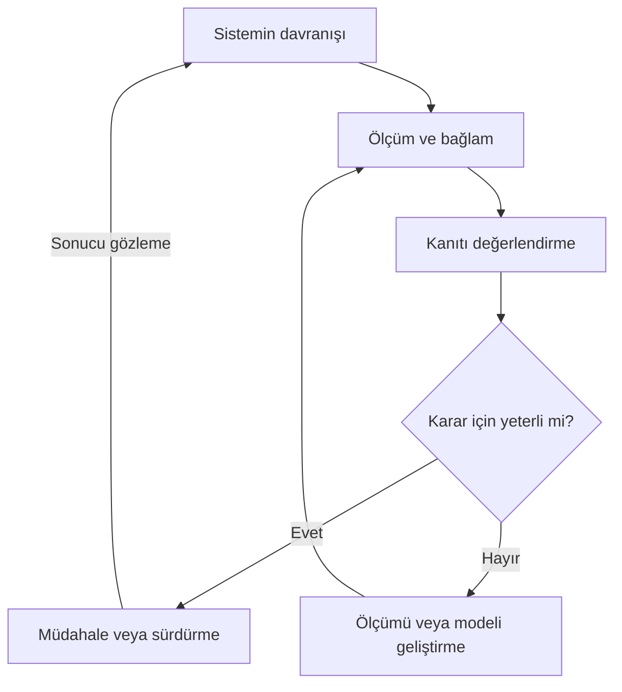

# Sistem Gözlemlenebilirliği Mühendisliği

**Protokoller ve Soru Yanıt Kaydı**

**Sürüm:** 1.0\
**Tarih:** 31 Ekim 2026

Sistem Gözlemlenebilirliği Mühendisliği, bir sistemin davranışını, bu davranışa ilişkin açıklamaların dayanaklarını ve kararların sonuçlarını anlayabilmek için gereken gözlem düzenini tasarlama, sınama ve sürdürme faaliyetidir. Bu belge, incelemeyi başlatan Tohum Protokolünü, varlık, mekân, usul, zaman ve gaye boyutlarını açıklayan beş protokolü ve incelemeyi sonuca bağlayan Kökleşme Protokolünü bir araya getirir.

Her protokol, paragraf ağırlıklı açıklamanın ardından başlangıç girdilerini, uygulanacak işleri, üretilecek kaydı ve tamamlanma ölçütünü verir. Uygulama, seçilen bir sistem veya soru için çalışma kaydı açılarak yürütülür. İlk geçişte 0–6 sırası izlenir; sonraki bir bölüm önceki varsayımı değiştirirse ilgili kayıt gerekçesiyle güncellenir. Kanıta dayanan gözlem, yorum, varsayım ve bilinmeyen birbirinden ayrılır.

Protokoller, gözlenen gerçek süreçleri, teknik taşıyıcıları ve sorumlu insanları birlikte ele alır. İncelemenin tamamlanması ile gerçek sistem üzerinde yeterliliğin gösterilmesi ayrı kaydedilir. Ek A ve Ek B iki kurucu soru-yanıtın tam metnini korur; kaynakça, teknik açıklamaların dayanaklarını içerir.

~~~text
  SISTEM GOZLEMLENEBILIRLIGI MUHENDISLIGI
    bir sistemin davranisini, bu davranisa iliskin aciklamalarin
    dayanaklarini ve kararlarin sonuclarini anlayabilmek icin gereken
    gozlem duzenini tasarlama, sinama ve surdurme faaliyeti

  BELGENIN DUZENI
    0 Tohum       incelemeyi baslatir
    1-5           varlik, mekan, usul, zaman ve gaye boyutlarini aciklar
    6 Koklesme    incelemeyi sonuca baglar
    her protokol:  aciklama  -->  baslangic girdileri  -->  uygulanacak
    isler  -->  uretilecek kayit  -->  tamamlanma olcutu
    ilk geciste 0-6 sirasi;  sonraki bolum onceki varsayimi degistirirse
    ilgili kayit gerekcesiyle guncellenir

  AYRI TUTULANLAR
    kanita dayanan gozlem | yorum | varsayim | bilinmeyen
    incelemenin tamamlanmasi  =/=  gercek sistem uzerinde yeterliligin
                                   gosterilmesi
    Ek A ve Ek B:  iki kurucu soru-yanitin tam metni
~~~

*Çizim 1 — Giriş: tanım; belgenin düzeni; ayrı tutulanlar.*

## 0 Tohum (Başlangıç) Protokolü

**Kurucu sorular:** Bu incelemeyi başlatan mesele nedir? Neden şimdi ele alınmaktadır? Hangi soru cevaplanmak istenmektedir? Başlangıçta ne bilinmekte, ne varsayılmakta ve ne açık kalmaktadır? Bu başlangıcı taşıyan süreç, düzenek ve sorumlu fail kimdir? Neler değildir?

Tohum Protokolü, gözlemlenebilirlik çalışmasının hangi durumdan doğduğunu ve hangi soruyu cevaplamak üzere başlatıldığını kayda geçirir. Bir sistemin davranışını açıklayamamak, mevcut kayıtlarla iki önemli durumu ayıramamak, bir değişikliğin sonucunu değerlendirememek veya gözlem düzeninin sorumluluğunu belirleyememek bu başlangıcı oluşturabilir. Başlangıç, gerçekleşmiş bir arızaya bağlı olmak zorunda değildir. Tasarım sırasında fark edilen bir belirsizlik veya henüz karşılaşılmamış bir duruma hazırlanma ihtiyacı da çalışmayı başlatabilir.

İlk iş, konunun adını somut bir inceleme sorusuna dönüştürmektir. Çalışma, hangi sistemin hangi davranışı hakkında neyin anlaşılmak istendiğini belirtir. Sorunun cevabının hangi düşünceyi, kararı veya işi etkileyebileceği açıklanır. İncelemeyi başlatma gerekçesi ile incelenen sistemin hizmet ettiği üst amaç ayrı tutulur; ikisi arasındaki ilişki Gaye Protokolünde geliştirilir. Böylece başlangıç, yalnızca veri toplama ya da araç kurma niyetinden daha belirli bir yön kazanır. Sorunun cevabı henüz bilinmese de cevabın neden önemli olduğu anlaşılır olmalıdır.

Bu soru, başlangıcı doğuran gözlemle birlikte kaydedilir. Bir olay kaydı, kullanıcı bildirimi, ölçüm, örnek işlem, tasarım kararı veya açıklanması gereken tutarsızlık başlangıç dayanağı olabilir. Dayanağın kaynağı, tarihi ve kapsamı belirtilir. Doğrudan gözlenen davranış ile bu davranış için düşünülen açıklama ayrı tutulur. Örneğin bir sonucun görünmemesi gözlem olabilir; sonucun hiç oluşmadığı ise ayrıca sınanması gereken bir açıklamadır.

Başlangıç bilgisi üç ayrı durumda değerlendirilir: dayanağı bulunan bilgiler, incelemeyi yönlendiren varsayımlar ve henüz cevaplanmamış sorular. Bu ayrım, bütün bilinmeyenlerin baştan çözülmesini gerektirmez. Hangi varsayımın sonraki adımları etkilediğini ve yanlış çıkarsa çalışmanın nereden yeniden ele alınacağını göstermeyi amaçlar. Kanıt bulunmayan yerde boşluk açık bırakılır; tahminler, kaydın içinde sonradan gerçekmiş gibi kullanılacak kesin ifadeler hâline getirilmez.

İncelemenin ilk sınırı bu aşamada çizilir. Ele alınan sistem, çalışma ortamı, örnek işlem veya olay aralığı tanımlanır. Başlangıçta kapsam dışında bırakılan alanlar ve bunun gerekçesi belirtilir. Dış bağımlılıklar, doğrudan görülemeyen davranışlar ve erişilemeyen kayıtlar, sonraki incelemeyi etkiledikleri ölçüde görünür tutulur. Bu sınır, gerçek sistemin bütününü tüketen bir tanım sayılmaz; çalışılabilir bir başlangıç noktası sağlar ve elde edilen kanıta göre değiştirilebilir.

~~~text
  BASLANGICI OLUSTURABILENLER
    sistemin davranisini aciklayamamak
    mevcut kayitlarla iki onemli durumu ayiramamak
    bir degisikligin sonucunu degerlendirememek
    gozlem duzeninin sorumlulugunu belirleyememek
    tasarimda fark edilen bir belirsizlik . henuz karsilasilmamis bir
    duruma hazirlanma ihtiyaci
    gerceklesmis bir ariza zorunlu degil

  KONU ADI  -->  SOMUT INCELEME SORUSU
    hangi sistemin hangi davranisi hakkinda ne anlasilmak isteniyor?
    cevap hangi dusunceyi, karari veya isi etkileyebilir?
    incelemeyi baslatma gerekcesi  =/=  sistemin hizmet ettigi ust amac
    ikisi arasindaki iliski Gaye Protokolunde gelisir

  BASLANGIC DAYANAGI  kaynagi, tarihi ve kapsamiyla
    olay kaydi . kullanici bildirimi . olcum . ornek islem . tasarim
    karari . aciklanmasi gereken tutarsizlik
    bir sonucun gorunmemesi      gozlem olabilir
    sonucun hic olusmadigi       ayrica sinanmasi gereken bir aciklama

  UC DURUM
    dayanagi bulunan bilgiler | yonlendiren varsayimlar | cevaplanmamis
    sorular
    kanit yoksa bosluk acik birakilir;  tahmin sonradan gercekmis gibi
    kullanilacak kesin ifadeye donusturulmez
~~~

*Çizim 2 — Tohum: başlangıcı oluşturabilenler; inceleme sorusu; başlangıç dayanağı; üç durum.*

Başlangıcı taşıyan makine, soruyu doğuran gerçek süreç, bu sürece ilişkin ilk kanıtlar ve incelemeyi yürüten sorumlu fail arasındaki örgütleniştir. Teknik taşıyıcılar dosyalar, ölçüm noktaları, kayıt ortamları ve inceleme araçları olabilir. Çalışmayı yürüten kişi veya ekip, başlangıç sorusunu, kanıtların durumunu ve kapsamı anlaşılır tutar. Aynı kişi birden fazla sorumluluğu üstlenebilir. Bir araç ya da otomasyonun kayıt üretmesi, incelemenin amacını ve yeterliliğini kendi başına belirlediği anlamına gelmez.

Tohum, sonraki beş protokolün inceleme yönünü hazırlar. Varlık için anlaşılması gereken şey; Mekan için davranışın ve kanıtın bulunduğu yerler; Usül için araştırılacak ayrım; Zaman için ilgili olay ve karar aralığı; Gaye için bilginin neden gerekli olduğu ilk biçimleriyle belirtilir. Bu başlangıç kayıtları, ileride yapılacak çözümlemenin yerine geçmez. Beş protokol, başlangıçtaki tanımları ayrıntılandırır ve gerektiğinde değiştirir; değişikliğin gerekçesi başlangıç kaydıyla ilişkilendirilir.

Masaüstünde uygulama, belirli bir inceleme için çalışma kaydı açılmasıyla başlar. Kayda incelemeyi ayırt eden bir ad, başlangıç tarihi, sorumlu kişi veya rol, ana soru ve mevcut dayanakların konumları yazılır. İnceleme sırasında kullanılacak kaynakların özgün hâlleri korunur; yorum ve çalışma notları bunlardan ayırt edilir. Çalışma kaydı, hangi bilginin nereden geldiğini sonraki bölümlerde tekrar bulmaya yetecek açıklığı sağlar. Dosyanın açılmış olması, içerdiği soruların cevaplandığı veya gözlem kapasitesinin sınandığı anlamına gelmez.

Tohum Protokolü, ana sorunun, sorunun öneminin, ilk kapsamın, başlangıç dayanaklarının ve sorumlu failin anlaşılabildiği durumda tamamlanır. Açık sorular ve varsayımlar kayıtlıdır; sonraki bölümlerin hangi mesele üzerinde çalışacağı bellidir. İnceleme için gereken temel bilgi henüz yoksa eksik bilgi ile onu edinmek için gereken sonraki iş yazılır ve başlangıcın durumu açık tutulur. Tamamlanma, bütün cevabın elde edilmesini değil, araştırmayı gerekçeli biçimde sürdürecek başlangıç durumunun kurulmasını ifade eder.

~~~text
  BASLANGICI TASIYAN MAKINE  bir orgutlenis
    soruyu doguran gercek surec
    bu surece iliskin ilk kanitlar
    incelemeyi yuruten sorumlu fail
    teknik tasiyicilar:  dosyalar . olcum noktalari . kayit ortamlari .
    inceleme araclari
    bir aracin kayit uretmesi  -/->  incelemenin amacini ve
                                     yeterliligini belirlemesi

  TOHUM BES PROTOKOLUN YONUNU HAZIRLAR
    Varlik    anlasilmasi gereken sey
    Mekan     davranisin ve kanitin bulundugu yerler
    Usul      arastirilacak ayrim
    Zaman     ilgili olay ve karar araligi
    Gaye      bilginin neden gerekli oldugu
    baslangic kayitlari ileride yapilacak cozumlemenin yerine gecmez

  MASAUSTU
    calisma kaydi:  ad . baslangic tarihi . sorumlu kisi veya rol . ana
    soru . dayanaklarin konumlari
    kaynaklarin ozgun halleri  =/=  yorum ve calisma notlari
    dosyanin acilmis olmasi  -/->  sorularin cevaplanmasi veya gozlem
                                   kapasitesinin sinanmasi
~~~

*Çizim 3 — Tohum: başlangıcı taşıyan makine; beş protokolün yönü; masaüstü.*

### Masaüstünde uygulama

**Başlamadan önce:** İncelemeyi doğuran olay, ihtiyaç, tasarım sorusu veya açıklanamayan durum ile elde bulunan ilk kayıtlar.

**Uygulama adımları**

1. Protokollerin ardından gelen çalışma kaydı şablonunu bu inceleme için kopyalayın; çalışma adını, tarihi, incelenen sistemi ve çalışmayı yürüten kişiyi yazın. İnceleme düzeyini kavramsal çalışma, mevcut kanıt incelemesi veya sistem üzerinde sınama olarak belirtin.

2. Kurucu soruyu tek bir açık cümleyle yazın. Cevabın hangi düşünceyi, kararı veya işi etkileyeceğini açıklayın.

3. Başlangıcı doğuran dayanakları K-01, K-02 gibi kimliklerle kaynak kaydına ekleyin. Dosya konumunu veya bağlantıyı ve ilgili tarih ya da sürümü belirtin.

4. İlk kapsamı, kapsam dışındaki alanları ve gerekçelerini yazın. Başlangıç gözlemlerini, yorumları, varsayımları ve bilinmeyenleri ayrı belirtin.

5. Eksik bilgi sonraki incelemeyi engelliyorsa edinilecek bilgiyi ve bunun için yapılacak işi kaydedin; Varlık Protokolüne geçişin durumunu belirtin.

**Kayda geçir:** Çalışma kaydının 0 bölümüne ana soru, önem gerekçesi, ilk kapsam, başlangıç dayanakları, varsayımlar ve açık sorular yazılır.

**Tamamlanma ölçütü:** Ne araştırılacağı, neden araştırılacağı ve ilk inceleme sınırı anlaşılırdır. Eksik bilgi varsa sonraki adımı nasıl etkilediği kayıtlıdır.

**Sonraki adım:** 1 Varlık Protokolü ile incelenen sistemi ve ayırt edilmesi gereken durumları belirginleştirin.

## 1 Varlık Protokolü

**Kurucu sorular:** Nedir? Onu o yapan nelerdir? Neler değildir? Köken aldığı varlığı taşıyan makine kimdir? Kim değildir?

Sistem Gözlemlenebilirliği Mühendisliğinin üzerinde çalıştığı şey, sistem hakkında gerekçeli bilgi edinme kapasitesidir. Bu kapasite, belirli bir soru, gözlem aralığı, ölçüm düzeni ve açıklama çerçevesi bakımından değerlendirilir. Bir sistemin kaynak tüketimini iyi görmek, aynı sistemin doğru sonuç üretip üretmediğini anlamaya yetmeyebilir. Bu nedenle gözlemlenebilirlikten söz ederken hangi davranışın, hangi ayrıntı düzeyinde ve hangi kanıtla anlaşılabildiği belirtilir.

Gözlemlenebilirlik, gözlemlenebilirlik altyapısı ve gözlemlenebilirlik mühendisliği ayrı kavramlardır. İlki önemli durumları ayırt edebilme kapasitesini, ikincisi ölçüm ve kayıt araçlarını, üçüncüsü ise bu kapasiteyi kuran ve sürdüren faaliyeti ifade eder. Bir ürünün kurulması, kayıtların akması veya bir panelin açılması bu faaliyetin yararlı çıktıları olabilir. Bununla birlikte, araçların çalışması tek başına önemli bir sorunun cevaplanabildiğini göstermez.

Kontrol kuramında gözlemlenebilirlik, belirli bir model altında ölçüm geçmişinden sistem durumunun belirlenebilmesiyle ilgilidir. Yazılım alanındaki kullanım, çalışan sistemin ürettiği sinyaller üzerinden davranışı araştırmayı ve önceden bütünüyle öngörülmemiş sorulara cevap aramayı da kapsar. Bu geniş kullanım, gerçek bir dağıtık sistemin bütün iç durumlarının aynı matematiksel kesinlikle yeniden kurulabileceği iddiasını taşımaz. [1, 2]

~~~text
  UZERINDE CALISILAN SEY
    sistem hakkinda gerekceli bilgi edinme kapasitesi
    degerlendirilir:  belirli bir soru . gozlem araligi . olcum duzeni .
    aciklama cercevesi bakimindan
    kaynak tuketimini iyi gormek  -/->  dogru sonuc uretilip
                                        uretilmedigini anlamak

  UC AYRI KAVRAM
    gozlemlenebilirlik               onemli durumlari ayirt edebilme
                                     kapasitesi
    gozlemlenebilirlik altyapisi     olcum ve kayit araclari
    gozlemlenebilirlik muhendisligi  bu kapasiteyi kuran ve surduren
                                     faaliyet
    araclarin calismasi  -/->  onemli bir sorunun cevaplanabilmesi

  IKI KULLANIM  [1, 2]
    kontrol kurami   belirli bir model altinda olcum gecmisinden sistem
                     durumunun belirlenebilmesi
    yazilim alani    calisan sistemin sinyalleri uzerinden davranisi
                     arastirmak;  ongorulmemis sorulara cevap aramak
    genis kullanim  -/->  dagitik sistemin butun ic durumlarinin ayni
                          matematiksel kesinlikle yeniden kurulmasi
~~~

*Çizim 4 — Varlık: üzerinde çalışılan şey; üç ayrı kavram; iki kullanım.*

Varlık bakımından gerçek sistem, ölçüm kaydı ve model birbirinden ayrılır. Gerçek süreç davranışı üretir; kayıt bu davranışın seçilmiş bir yönünü taşır; model ise kayıtları belirli ilişkiler içinde yorumlamayı sağlar. Seçilen değişkenler ve sistem sınırı, hangi açıklamanın mümkün olduğunu etkiler. Bu seçimler gerçekliğin keyfî olarak kurulması anlamına gelmez. Gerçek davranış, kullanılan modeli yetersiz bırakabilir veya yanlışlayabilir.

Örneğin bir işlem sayacının sıfır göstermesi, hiç iş gelmemesiyle, gelen işin işlenememesiyle veya ölçüm verisinin ulaşmamasıyla uyumlu olabilir. Bu durumlar farklı kararlar gerektirir. Gözlem düzeninin değeri, bunları birbirinden ayırmaya yetecek kanıtı sağlamasında ortaya çıkar. Ayırt edilemeyen durumların açıkça belirtilmesi de kapasitenin bir parçasıdır; bilinmeyenin görünür olması, yanlış bir kesinlik üretilmesini önler.

~~~text
  UC DUZEY
    gercek surec      davranisi uretir
         |
         v
    kayit             davranisin secilmis bir yonunu tasir
         |
         v
    model             kayitlari belirli iliskiler icinde yorumlar
    secimler gercekligin keyfi kurulmasi degil;  gercek davranis modeli
    yetersiz birakabilir veya yanlislayabilir

  SAYAC ORNEGI
    hic is gelmedi              \
    gelen is islenemedi          >----  islem sayaci:  0
    olcum verisi ulasmadi       /
    uc durum ayni okumayla uyumlu;  farkli kararlar gerektirir
    gozlem duzeninin degeri:  bunlari ayirmaya yetecek kaniti saglamasi
    ayirt edilemeyen durumlarin acikca belirtilmesi de kapasitenin
    parcasi;  bilinmeyenin gorunmesi yanlis bir kesinligi onler
~~~

*Çizim 5 — Varlık: süreç, kayıt ve model; sayaç örneği.*

Bu varlığı taşıyan makine, gözlenen gerçek süreç ile onun hakkında kanıt üreten ve kanıtı değerlendiren düzenin ilişkisinde bulunur. Burada makine sözcüğü, belirli bir cihazı veya yerleşik ürün sınıfını değil, işi mümkün kılan örgütlenişi adlandırır. Teknik taşıyıcılar ölçüm noktaları, kayıtlar, iletişim kanalları ve modellerdir. Mühendislik faaliyetinin faili ise bunları kuran, sınayan ve sürdüren insan, ekip veya kurumdur. Teknik işlevlerin otomasyona dağıtılması, amaç ve yeterlilik konusundaki sorumluluğu kendiliğinden ortadan kaldırmaz.

Bu protokol, gözlemlenebilirliği tam bilgi, hatasızlık veya özbilinçle özdeşleştirmez. Çok anlaşılır bir sistem yanlış çalışabilir; uzun süre iyi çalışan bir sistemin beklenmedik davranışı açıklanamayabilir. Gözlenen sistemin kendisini izlemesi, amaç seçmesi veya kendisini onarması da zorunlu değildir. Gözlem kapasitesi dışarıdaki bir düzen tarafından kurulabilir. Bir durumu anlayabilmek ile onu değiştirebilmek ayrı özelliklerdir.

Varlık Protokolünün koruduğu temel kayıt, hangi sistemin hangi durumları bakımından neyin bilinebildiği ve bu bilginin hangi sınırlar içinde geçerli olduğudur. Tanımın değeri, araç adlarında veya veri miktarında değil, önemli ayrımların yapılabildiğinin gösterilmesinde bulunur. Telemetri, izleme, test, hata ayıklama ve güvenilirlik mühendisliği bu kapasiteyle kesişir; her birinin sorumluluğu bütünüyle aynı değildir.

~~~text
  VARLIGI TASIYAN MAKINE
    gozlenen gercek surec  <---->  kanit ureten ve kaniti degerlendiren
                                   duzen
    "makine":  belirli bir cihaz veya yerlesik urun sinifi degil;  isi
    mumkun kilan orgutlenis
    teknik tasiyicilar   olcum noktalari . kayitlar . iletisim
                         kanallari . modeller
    fail                 bunlari kuran, sinayan ve surduren insan, ekip
                         veya kurum
    teknik islevlerin otomasyona dagitilmasi  -/->  amac ve yeterlilik
    sorumlulugunun ortadan kalkmasi

  OZDES DEGIL
    gozlemlenebilirlik  =/=  tam bilgi . hatasizlik . ozbilinc
    cok anlasilir bir sistem yanlis calisabilir
    gozlenen sistemin kendini izlemesi, amac secmesi, kendini onarmasi
    zorunlu degil;  kapasite disaridaki bir duzence kurulabilir
    bir durumu anlayabilmek  =/=  onu degistirebilmek

  KESISEN ALANLAR  sorumluluklari butunuyle ayni degil
    telemetri . izleme . test . hata ayiklama . guvenilirlik
    muhendisligi
~~~

*Çizim 6 — Varlık: varlığı taşıyan makine; özdeş olmayanlar; kesişen alanlar.*

### Masaüstünde uygulama

**Başlamadan önce:** Tohum kaydı, kurucu soru ve incelenecek sistem hakkında elde bulunan açıklamalar veya kayıtlar.

**Uygulama adımları**

1. İncelenen sistemi ve ilgili davranışı tanımlayın. Gözlemlenebilirlik kapasitesini, altyapıyı ve mühendislik faaliyetini bu örnekte ayırın.

2. Farklı kararlar gerektiren en az bir durum ayrımı yazın. Aynı kaydın birden fazla durumla uyumlu olabileceği koşulu belirtin.

3. Gerçek süreç, onu temsil eden kayıt ve kaydı yorumlayan model için ayrı açıklama yazın. Teknik taşıyıcı ile çalışmadan sorumlu kişi veya rolü belirtin.

4. Mevcut dayanakları inceleyerek hangi ayrımın yapılabildiğini ve hangisinin henüz yapılamadığını kaydedin. Her önemli iddiayı kaynağına veya varsayımına bağlayın.

**Kayda geçir:** 1 bölümüne sistem ve davranış tanımı, önemli durum ayrımları, süreç–kayıt–model ayrımı, taşıyıcılar, sorumluluk ve bilme sınırları yazılır.

**Tamamlanma ölçütü:** En az bir önemli durum ayrımı somuttur. Mevcut bilgilerle neyin anlaşılabildiği ve neyin ayrılamadığı açıkça görülür.

**Sonraki adım:** 2 Mekan Protokolü ile bu davranışın ve kanıtın bulunduğu yerleri izleyin. Sistem tanımı değişirse 0 bölümündeki kapsamı gerekçesiyle güncelleyin.

## 2 Mekan Protokolü

**Kurucu sorular:** Nerededir? Bu yeri, oraya has bir yer yapan nelerdir? Neler değildir? Köken aldığı mekânı taşıyan makine kimdir? Kim değildir?

Gözlemlenebilirlik mühendisliğinin somut yerleşimi, işin gerçekleştiği noktadan kanıtın kullanıldığı karar ortamına uzanır. Ölçüm noktaları, uygulama kodu, fiziksel sensörler, bağlantılar, veri taşıma hatları, kayıt ortamları ve sorgulama araçları bu yerleşimin parçalarıdır. Disiplinin bütünlüğü tek bir bileşenin içinde değil, bu parçalar arasındaki ilişkinin korunmasında oluşur.

Mekân, fiziksel konumun yanında sistem içindeki konumu ve örgütsel sorumluluk alanını da kapsar. Bir hizmetin içinden yapılan ölçüm, kullanıcının karşılaştığı sonucu doğrudan temsil etmeyebilir. Bir üretim sürecinin başındaki gözlem, sonunda oluşan niteliği açıklamaya yetmeyebilir. Her gözlemin nereden yapıldığı, hangi sınırın içini doğrudan gördüğü ve hangi sınırın ötesinde yalnız etkileri izleyebildiği anlaşılır kalır.

Gözlemin iç ve dış konumları birbirini tamamlar. İç ölçümler, mekanizmaları ve durum geçişlerini incelemeye yardım eder. Dış kontroller, sistemin sunduğu sonucun beklenen biçimde elde edilip edilmediğini gösterir. Bu iki konumun birlikte değerlendirilmesi, bileşenlerin kendi başarı kayıtlarıyla bütün sistemin sonucu arasındaki farkı görünür kılabilir. [4]

~~~text
  YERLESIM
    isin gerceklestigi noktadan kanitin kullanildigi karar ortamina
    olcum noktalari . uygulama kodu . fiziksel sensorler . baglantilar .
    veri tasima hatlari . kayit ortamlari . sorgulama araclari
    butunluk:  tek bir bilesende degil, parcalar arasindaki iliskinin
    korunmasinda
    mekan:  fiziksel konum + sistem icindeki konum + orgutsel sorumluluk
    alani

  IC VE DIS GOZLEM  birbirini tamamlar  [4]
    +------------------- sistem -------------------+
    |  bilesen  ---->  bilesen  ---->  bilesen     |
    |   [i]             [i]             [i]        |---->  sunulan sonuc
    +----------------------------------------------+         [d]
    [i]  ic olcum:  mekanizmalar ve durum gecisleri
    [d]  dis kontrol:  sistemin sundugu sonuc beklenen bicimde elde
         ediliyor mu?
    bilesenlerin kendi basari kayitlari  =/=  butun sistemin sonucu
    her gozlem:  nereden yapildi? . hangi sinirin icini dogrudan
    gorur? . hangi sinirin otesinde yalniz etkileri izler?
~~~

*Çizim 7 — Mekan: yerleşim; iç ve dış gözlem.*

İşin bir bileşenden diğerine devredildiği yerler özellikle önemlidir. Çağrılar, mesajlar, kuyruklar, yeniden denemeler ve veri dönüşümleri boyunca iş sürerken onu açıklayan bağlam kopabilir. Kayıtların tamamı mevcut olsa bile aynı işin parçaları oldukları bilinmiyorsa bütün akış anlaşılamaz. Dağıtık izlemede bağlam aktarımı, işlem ve işlem adımı ilişkilerini süreç ve ağ sınırları boyunca korumaya hizmet eder. [5]

Bu ilişki yalnızca bileşenler arasında kurulmaz. Bileşenin içindeki anlamlı durum değişimleri de gözlem kapsamına girer. Bir mesajın ulaştığını bilmek, doğru işlendiğini bilmeye yetmez. Benzer biçimde, dış bir bağımlılığın etkisini ölçebilmek, o bağımlılığın bütün iç nedenlerini bildiğimiz anlamına gelmez. Sistemin inceleme sınırı, sahip olunan donanımın sınırıyla otomatik olarak aynı kabul edilmez.

Mekânı taşıyan makine, olayın bulunduğu yerden yorumun yapıldığı yere uzanan somut bağlantılardır. Bu bağlantıların her biri bilginin çözünürlüğünü, anlamını veya erişilebilirliğini değiştirebilir. Gözlem düzeni, gerçek davranış ile onun karar verene ulaşan temsili arasındaki farkı değerlendirir. Temsilin eksik veya gecikmiş olması, temsil edilen olayın gerçekleşmediği sonucunu tek başına doğurmaz.

~~~text
  ISIN DEVREDILDIGI YERLER  baglam kopabilir
    hizmet --cagri--> hizmet --mesaj--> [ kuyruk ] --> hizmet
     kayit             kayit                            kayit
    cagrilar . mesajlar . kuyruklar . yeniden denemeler . veri
    donusumleri
    kayitlarin tamami mevcut, ama ayni isin parcalari olduklari
    bilinmiyorsa  -->  butun akis anlasilamaz
    baglam aktarimi  [5]:  islem ve islem adimi iliskileri, surec ve ag
    sinirlari boyunca korunur

  BILMEYE YETMEZ
    bir mesajin ulastigini bilmek  -/->  dogru islendigini bilmek
    dis bir bagimliligin etkisini olcmek  -/->  butun ic nedenlerini
                                                bilmek
    inceleme siniri  =/=  sahip olunan donanimin siniri

  MEKANI TASIYAN MAKINE
    olayin bulundugu yer
       ||  somut baglantilar
       vv
    yorumun yapildigi yer
    her baglanti bilginin cozunurlugunu, anlamini veya
    erisilebilirligini degistirebilir
    temsilin eksik veya gecikmis olmasi  -/->  olayin gerceklesmemis
                                               olmasi
~~~

*Çizim 8 — Mekan: işin devredildiği yerler; bilmeye yetmeyenler; mekânı taşıyan makine.*

Örgütsel devirler de bu mekânın parçasıdır. Bir geliştirici olayın alan içindeki anlamını, platform ekibi verinin taşınmasını, işletim ekibi müdahale ihtiyacını, hizmet sahibi ise beklenen sonucu daha iyi biliyor olabilir. Bir sinyalin ne anlama geldiği, kim tarafından kullanıldığı, anlamı değişirse kimin fark edeceği ve üretimi bozulursa kimin düzelteceği açıklanabildiğinde bu farklı konumlar ortak bir gözlem düzeninde birleşir.

Mekan Protokolü, disiplinin yerini yalnızca panel, operasyon odası, arka uç, veri merkezi veya tek bir ekip olarak tanımlamaz. Bunlar kapasitenin parçalarını barındırabilir. Bütünün yeri, işin, kanıtın ve sorumluluğun geçtiği ilişkilerde belirlenir. İnsanların yürüttüğü süreçlere yapılan uyarlama da bütün niyetlerin veya yaşantıların kayıtlardan okunabileceği iddiasını içermez.

~~~text
  ORGUTSEL DEVIRLER  daha iyi biliyor olabilecekleri
    gelistirici        olayin alan icindeki anlami
    platform ekibi     verinin tasinmasi
    isletim ekibi      mudahale ihtiyaci
    hizmet sahibi      beklenen sonuc

  ORTAK BIR GOZLEM DUZENINDE BIRLESIR, BU SORULAR CEVAPLANABILDIGINDE
    sinyal ne anlama geliyor?
    kim tarafindan kullaniliyor?
    anlami degisirse kim fark edecek?
    uretimi bozulursa kim duzeltecek?

  YALNIZCA BUNLAR DEGIL
    panel . operasyon odasi . arka uc . veri merkezi . tek bir ekip:
    kapasitenin parcalarini barindirabilir
    butunun yeri:  isin, kanitin ve sorumlulugun gectigi iliskiler
    insan sureclerine uyarlama  -/->  butun niyetlerin veya yasantilarin
    kayitlardan okunabilmesi
~~~

*Çizim 9 — Mekan: örgütsel devirler; ortak gözlem düzeninin soruları.*

### Masaüstünde uygulama

**Başlamadan önce:** Sistem tanımı, önemli durum ayrımları, mevcut bileşen bilgileri ve kanıt kaynakları.

**Uygulama adımları**

1. Bir önemli olay veya örnek işlem seçin. Olayın gerçekleştiği noktadan yorumun ve kararın oluştuğu yere kadar yolu yazın.

2. Her aşamada hangi kanıtın nerede üretildiğini, nasıl taşındığını ve nerede saklandığını belirtin. Doğrudan gözlenen yerlerle yalnızca etkileri görülen yerleri ayırın.

3. Bileşen, süreç veya ekip geçişlerinde aynı işe ait kayıtların nasıl ilişkilendirildiğini inceleyin. Bağlamın koptuğu veya aktarımın bilinmediği yerleri işaretleyin.

4. Kanıtın üretimi, taşınması, anlamlandırılması ve kullanımından sorumlu kişi veya rolleri yazın. Belirlenmemiş sorumluluğu açık iş olarak kaydedin.

**Kayda geçir:** 2 bölümüne olaydan karara gözlem yolu, kaynak konumları, sınırlar, bağlam ilişkileri, kopuk geçişler ve sorumluluklar yazılır. Gerekiyorsa küçük bir tablo kullanılır.

**Tamamlanma ölçütü:** Gerekli kanıtın nerede üretildiği, hangi yoldan ulaştığı ve nerede yorumlandığı izlenebilir. Bilinmeyen veya kopuk geçişler görünürdür.

**Sonraki adım:** 3 Usül Protokolü ile önemli soruların bu kanıtlarla nasıl değerlendirileceğini belirleyin.

## 3 Usül Protokolü

**Kurucu sorular:** Nasıl işler yapar? Bu yaptıklarını, ona has yapan nelerdir? Neler değildir? Köken aldığı usulü taşıyan makine kimdir? Kim değildir?

Gözlemlenebilirlik mühendisliğinin usulü, önemli bir soruyu hangi kanıtın cevaplayabileceğini belirlemekle başlar. Hangi kararların verileceği ve hangi durumların farklı kararlar gerektirdiği açıklaştırılır. Böylece ölçüm, yalnız mevcut araçların sunduğu verilere göre değil, anlaşılması gereken davranışa göre tasarlanır. Aynı sistem, farklı kararlar için farklı ayrıntı düzeyleri gerektirebilir.

Başarının anlamı bu tasarımın başlangıcında açıklanır. Bir sipariş sisteminde isteğin başarılı cevap alması, siparişin iş açısından tamamlanmasıyla aynı olay değildir. Kabul, ödeme, stok ayırma ve tamamlama gibi durumların hangi sözü verdiği belirlenirse, ölçümler gerçek bir ayrımı destekleyebilir. Hizmet seviyesi göstergeleri de kullanıcı veya hizmet açısından önemli davranışların ölçülmesine dayanır. [6]

Kanıt türleri soruya göre seçilir. Metrikler miktarları ve dağılımları, olay kayıtları gerçekleşen durum geçişlerini, dağıtık izler bir işin bileşenler boyunca izlediği yolu, profiller ise çalışan kodun kaynak tüketimini incelemeye yardım eder. Dış kontroller ve alana özgü sonuç kayıtları, teknik adımların beklenen sonuca ulaşıp ulaşmadığını değerlendirmeyi sağlar. Bu araçlardan belli sayıda türün bulunması, gözlem kapasitesinin yeterli olduğunu göstermez. [7]

Üretilen kanıtın anlamı ve ilişkileri korunur. Olayın hangi işleme, sürüme ve çalışma ortamına ait olduğu; kullanılan birimler; yeniden denemelerle yeni işlemler arasındaki fark; farklı kayıtların hangi ilişki üzerinden bir araya getirildiği açık olmalıdır. Ortak adlandırmalar karşılaştırmayı kolaylaştırır; her sistemin alanına özgü anlamların ayrıca tanımlanması gerekir. [8]

~~~text
  USUL SORUYLA BASLAR
    hangi kanit onemli bir soruyu cevaplayabilir?
    hangi kararlar verilecek?
    hangi durumlar farkli kararlar gerektirir?
    olcum:  mevcut araclarin verilerine gore degil, anlasilmasi gereken
    davranisa gore tasarlanir

  BASARININ ANLAMI  siparis ornegi
    istegin basarili cevap almasi  =/=  siparisin is acisindan
                                        tamamlanmasi
    kabul . odeme . stok ayirma . tamamlama:  her durumun hangi sozu
    verdigi belirlenirse olcumler gercek bir ayrimi destekleyebilir
    hizmet seviyesi gostergeleri  [6]:  kullanici veya hizmet acisindan
    onemli davranislarin olculmesi

  KANIT TURLERI  [7]
    metrikler                 miktarlar ve dagilimlar
    olay kayitlari            gerceklesen durum gecisleri
    dagitik izler             bir isin bilesenler boyunca izledigi yol
    profiller                 calisan kodun kaynak tuketimi
    dis kontroller, alana     teknik adimlar beklenen sonuca ulasti mi?
    ozgu sonuc kayitlari
    belli sayida turun bulunmasi  -/->  yeterli gozlem kapasitesi

  KANITIN ANLAMI  [8]
    hangi isleme, surume ve ortama ait? . birimler . yeniden deneme mi,
    yeni islem mi? . kayitlar hangi iliskiyle bir araya getirildi?
~~~

*Çizim 10 — Usül: soru; başarının anlamı; kanıt türleri; kanıtın anlamı.*

Usulün bir sonraki işi, açıklamaları kanıtla karşılaştırmaktır. Bir sorunun belirli bir değişiklikten sonra görülmesi, o değişikliğin neden olduğu yönünde bir hipotez sağlayabilir. Ancak trafik, bağımlılıklar veya başka koşullar da değişmiş olabilir. Yöntem, makul bir anlatı kurmakla yetinmeyip aynı kanıtla uyumlu alternatif açıklamaları değerlendirebilir hâle getirir. Korelasyon, yürütme ilişkisi ve nedensel açıklama ayrı iddialar olarak korunur.

Ölçüm düzeni de işletilen ve sınanan bir sistemdir. Veri kaybı, gecikme, kuyruk birikmesi, aktarım başarısızlığı ve örnekleme kararları çıkarımların gücünü etkiler. Bir hata göstergesinin sıfıra düşmesi, kayıt akışının da kesildiği koşullarda iyileşme kanıtı sayılamaz. Gözlem hattının sağlığına ilişkin kanıt, gözlenen sistem hakkındaki kanıtın değerlendirilmesine katkı verir. [9]

Örnekleme, saklama ve ayrıntı kararları maliyetle birlikte değerlendirilir. Hangi olayların görünmeyebileceği veya hangi soruların artık cevaplanamayacağı anlaşılmalıdır. Hatalı işlemlerin özellikle daha sık saklandığı bir örneklem, gerekli düzeltmeler yapılmadan bütün sistemin hata oranını temsil etmez. Daha fazla veri her durumda daha iyi bir açıklama sağlamadığı gibi, düşük veri hacmi de kendiliğinden yeterli temsil anlamına gelmez. [10]

~~~text
  ACIKLAMA KANITLA KARSILASTIRILIR
    sorun bir degisiklikten sonra goruldu  -->  bir hipotez:  degisiklik
    neden olmus olabilir
    ama ayni anda:  trafik . bagimliliklar . baska kosullar
    ayri iddialar:  korelasyon | yurutme iliskisi | nedensel aciklama

  OLCUM DUZENI DE ISLETILEN VE SINANAN BIR SISTEM  [9]
    veri kaybi . gecikme . kuyruk birikmesi . aktarim basarisizligi .
    ornekleme kararlari:  cikarimlarin gucunu etkiler
    hata gostergesi sifira dustu  +  kayit akisi da kesildi
       -->  iyilesme kaniti sayilamaz

  ORNEKLEME  [10]
    butun islemler      o o o o x o o o o o o o x o o o o o o o o x o o
    hatalilarin daha    o       x       o       x       o       x
    sik saklandigi
    ornek
    gerekli duzeltmeler yapilmadan, ornekteki hata orani butun sistemin
    hata oranini temsil etmez
    daha fazla veri  -/->  her durumda daha iyi aciklama
    dusuk veri hacmi  -/->  kendiliginden yeterli temsil
~~~

*Çizim 11 — Usül: açıklama ve kanıt; ölçüm düzeni; örnekleme.*

Usulü taşıyan makine, ölçümden yargıya uzanan yolu incelemeye açabilen düzenektir. İnsanlar ve otomasyon bu yolun farklı işlerini gerçekleştirebilir. Buna rağmen çıkarımın kaynağı, kapsamı, varsayımları ve değerlendirme sorumluluğu anlaşılır kalır. Ölçüm hattının kendi durumunu raporlaması teknik bir inceleme kapasitesidir; bunu özbilinç veya eksiksiz kendilik bilgisi olarak yorumlamak gerekmez.

Bu protokolde sınanacak şey, yalnızca uygulamanın doğru çalışması değildir. Kontrollü bir deneme veya gerçek olay incelemesi sırasında önemli durumların fark edilip edilmediği, etkilenen işlemlerin ayrılıp ayrılamadığı, açıklamaların daraltılıp daraltılamadığı ve eksik kanıtın belirlenip belirlenemediği de incelenir. Sonuçlar ölçüm tasarımını geliştirmeye geri döner. Panelin açılması, her hataya alarm bağlanması veya daha çok kayıt tutulması bu sınamanın yerine geçmez.

~~~text
  USULU TASIYAN MAKINE  olcumden yargiya uzanan yolu incelemeye
                        acabilen duzenek
    insanlar ve otomasyon bu yolun farkli islerini yapabilir
    anlasilir kalir:  cikarimin kaynagi . kapsami . varsayimlari .
    degerlendirme sorumlulugu
    olcum hattinin kendi durumunu raporlamasi:  teknik bir inceleme
    kapasitesi  =/=  ozbilinc veya eksiksiz kendilik bilgisi

  SINAMA  kontrollu deneme veya gercek olay incelemesi
    onemli durumlar fark edildi mi?
    etkilenen islemler ayrilabildi mi?
    aciklamalar daraltilabildi mi?
    eksik kanit belirlenebildi mi?
         |
         +-->  sonuclar olcum tasarimini gelistirmeye doner

  SINAMANIN YERINE GECMEZ
    x  panelin acilmasi
    x  her hataya alarm baglanmasi
    x  daha cok kayit tutulmasi
~~~

*Çizim 12 — Usül: usulü taşıyan makine; sınama; sınamanın yerine geçmeyenler.*

### Masaüstünde uygulama

**Başlamadan önce:** Ayırt edilecek durumlar, gözlem yolu ve erişilebilen kanıtlar.

**Uygulama adımları**

1. Her önemli soru için gerekli kanıtı ve kullanılacak karşılaştırma yöntemini yazın. Kanıtın birimini, anlamını, kapsamını ve ilişkilendirme bilgisini belirtin.

2. Aynı gözlemle uyumlu alternatif açıklamaları yazın. Bunları birbirinden ayırabilecek ek gözlemi veya denemeyi tanımlayın.

3. Veri kaybı, gecikme, örnekleme veya tanım değişikliğinin çıkarımı nasıl etkileyebileceğini değerlendirin. Bilinen sorunları kaynak kaydıyla ilişkilendirin.

4. Çalışma kapsamındaki mevcut bir örnek üzerinde yöntemi uygulayın veya yapılacak sınamayı tasarlayın. Gerçekleştirilen işi ve yalnızca planlanan işi ayrı kaydedin.

5. Elde edilen sonucu, dayanağını ve sınırını yazın. Kanıt yetersizse yapılabilen ayrımı ve eksik kalan ayrımı belirtin.

**Kayda geçir:** 3 bölümüne soru–kanıt eşlemesi, değerlendirme yöntemi, alternatif açıklamalar, gözlem hattının bilinen sınırlamaları ve deneme durumu yazılır.

**Tamamlanma ölçütü:** Hangi iddianın hangi kanıta dayanacağı ve yöntemin nasıl sınanacağı bellidir. Uygulanan değerlendirme ile planlanan değerlendirme ayırt edilir.

**Sonraki adım:** 4 Zaman Protokolü ile kanıtın ilgili karar için zaman bakımından yeterliliğini değerlendirin. Kaynak veya bağlam eksikliği varsa 2 bölümüne dönün.

## 4 Zaman Protokolü

**Kurucu sorular:** Hangi andadır? Bu anı, diğer zamanlardan farklı yapan nelerdir? Neler değildir? Köken aldığı zamanı taşıyan makine kimdir? Kim değildir?

Gözlemlenebilirliğin zamanı, olayın gerçekleşmesi, kanıtın kullanılabilir hâle gelmesi ve kararın verilmesi gereken an arasındaki ilişkide oluşur. Bu üç an aynı olmayabilir. Bir kayıt doğru olduğu hâlde belirli bir karar için geç kalabilir; çok hızlı ulaşan bir kayıt ise gereken bağlamı taşımayabilir. Tazelik, ayrıntı düzeyi ve güvenilirlik birlikte değerlendirilir.

Gerekli gözlem penceresi, kararın zaman ölçeğinden türetilir. Kısa sürede verilen bir müdahale kararıyla uzun dönem kapasite kararı aynı geçmiş uzunluğunu veya veri çözünürlüğünü gerektirmez. Gecikmiş veriler, yapılan değişikliğin etkisinin henüz görünmediği durumlarda yanlış değerlendirmelere yol açabilir. Bu nedenle ölçüm ve yorumlama düzeninin gecikmeleri, kararın bekleyebileceği süreyle ilişkilendirilir. [3]

Zamanın bu boyutu, değişiklik değerlendirmesinde de önemlidir. Kısa süreli bir denemeyi uzun bir toplama penceresiyle yorumlamak, deneme öncesindeki olayları değerlendirmeye karıştırabilir. Değişikliğe maruz kalan ve kalmayan grupların, uygun zaman aralıklarında ayrı incelenebilmesi gerekir. Bir işlemin sonucunu değerlendirme süresi, o sonucun oluşabileceği süreyi de dikkate alır. [11]

~~~text
  UC AN  ayni olmayabilir
    olay            kanit kullanilabilir         kararin verilmesi
    gerceklesir     hale gelir                   gereken an
       o ------------------> o ------------------------> o
    dogru bir kayit belirli bir karar icin gec kalabilir
    cok hizli ulasan bir kayit gereken baglami tasimayabilir
    birlikte degerlendirilir:  tazelik . ayrinti duzeyi . guvenilirlik

  GOZLEM PENCERESI  kararin zaman olceginden turetilir  [3]
    kisa surede verilen mudahale karari  =/=  uzun donem kapasite karari
    gecikmis veri:  degisikligin etkisi henuz gorunmuyorsa yanlis
    degerlendirmeye yol acabilir

  DEGISIKLIK DEGERLENDIRMESI  [11]
    toplama penceresi    [====================================]
    kisa sureli deneme                             [=========]
    pencerenin deneme oncesi kismi:  deneme oncesindeki olaylar
    degerlendirmeye karisabilir
    degisiklige maruz kalan ve kalmayan gruplar uygun araliklarda ayri
    incelenir
~~~

*Çizim 13 — Zaman: üç an; gözlem penceresi; değişiklik değerlendirmesi.*

Mühendislik faaliyeti, kanıta ihtiyaç doğmadan önce başlar. Tasarım sırasında ileride önemli olabilecek durum geçişleri ve bağlamlar düşünülür. Sistem çalışırken normal davranışa, değişkenliğe ve istisnalara ilişkin kayıtlar oluşur. Değişiklik sırasında eski beklentilerin yeni koşullarda geçerli olup olmadığı sınanır. Olayın ardından ise hem davranışa ilişkin açıklama hem gözlem düzeninin yeterliliği değerlendirilir.

Bu disiplinin zamansal gerilimi, bugün gerçekleşen olaylar hakkında gelecekte sorulabilecek sorulara hazırlanırken bütün soruları önceden bilememesidir. Çözüm, sınırsız kayıt hedefi değil, anlamlı bağlamı koruyan ve yeni öğrenmelerle değiştirilebilen bir tasarımdır. Olay sırasında korunmayan bazı bilgiler sonradan elde edilemeyebilir. Geçmiş davranıştan geleceğe ilişkin çıkarım yapılması da ayrıca model ve varsayım gerektirir.

Zaman sırası ile nedensel sıra birbirinden ayrılır. Farklı bileşenlerin saatleri ve kayıtların ulaşma sıraları farklı olabilir; önce gerçekleşmek tek başına neden olmak anlamına gelmez. Dağıtık olaylar arasındaki nedensel ilişkinin kısmi sıralama niteliği, zaman damgalarının yürütme ve mesaj ilişkileriyle birlikte değerlendirilmesini gerektirir. [12]

Zamanı taşıyan makine yalnızca kayıtların belleği değildir. Kayıtların hangi koşullarda geçerli kaldığını değerlendiren düzen de bu taşıyıcının parçasıdır. Bir ölçüm tanımı, sürüm veya kapsam değiştiğinde, sayısal değerlerin geçmişle karşılaştırılması yeniden ele alınabilir. Belleğin varlığı, bellekteki bilginin bugünkü soruya uygunluğunu kendiliğinden sağlamaz.

Zaman Protokolü, gözlemlenebilirliği yalnızca arıza anına, olay sonrası incelemeye veya gerçek zamanlı ekrana yerleştirmez. Disiplin, kanıtın bir açıklamayı veya kararı değiştirebildiği zamanlarda değer üretir. Bir sistemin değişmesi, eski modelin yetmemesi veya gözlem düzeninin anlam kaybetmesi bu yeniden değerlendirmeyi başlatabilir. Doğrudan müdahale yetkisinin bulunmaması, elde edilen bilginin başka kararlar için yararlı olmasını engellemez.

~~~text
  KANITA IHTIYAC DOGMADAN ONCE BASLAR
    tasarim sirasinda     ileride onemli olabilecek durum gecisleri ve
                          baglamlar
    sistem calisirken     normal davranis . degiskenlik . istisnalar
    degisiklik sirasinda  eski beklentiler yeni kosullarda gecerli mi?
    olayin ardindan       davranisin aciklamasi + gozlem duzeninin
                          yeterliligi
    gerilim:  gelecekte sorulabilecek butun sorular onceden bilinemez
    cozum:  sinirsiz kayit degil;  anlamli baglami koruyan, yeni
    ogrenmelerle degistirilebilen tasarim

  ZAMAN SIRASI  =/=  NEDENSEL SIRA  [12]
    bilesen A    a1 ------- a2 ------------------- a3
                              \
                               \  mesaj
                                \
    bilesen B    b1 ------------ b2 ------- b3
    a2 --> b2:  mesaj iliskisi uzerinden siralanir
    a3 ile b3:  saat degerleri ne olursa olsun, aralarinda bu cizimde
    nedensel bir yol yok
    once gerceklesmek  -/->  neden olmak

  ZAMANI TASIYAN MAKINE
    kayitlarin bellegi  +  kayitlarin hangi kosullarda gecerli kaldigini
    degerlendiren duzen
    olcum tanimi, surum veya kapsam degisirse  -->  gecmisle
    karsilastirma yeniden ele alinir
~~~

*Çizim 14 — Zaman: yaşam döngüsü; zaman sırası ve nedensel sıra; zamanı taşıyan makine.*

### Masaüstünde uygulama

**Başlamadan önce:** Olay ve kanıt kayıtları, değerlendirme yöntemi ve verilecek kararın zaman ihtiyacı.

**Uygulama adımları**

1. Seçilen olayın gerçekleşme zamanını, kanıtın erişilebilir olduğu zamanı ve kararın verilmesi gereken zamanı ayrı kaydedin. Saat dilimini ve bilinmeyen zamanları belirtin.

2. Kararın gerektirdiği gözlem penceresini, veri çözünürlüğünü ve kabul edilebilir gecikmeyi gerekçelendirin. Gerekli sınır henüz bilinmiyorsa bunu açık soru olarak kaydedin.

3. Saat farkı, toplama penceresi, geç ulaşan kayıt veya yeniden denemenin olay sırasını nasıl etkilediğini inceleyin. Yalnız zaman sırasından nedensellik çıkarmayın.

4. Ölçüm tanımı, sistem sürümü veya kapsam değiştiğinde geçmişle karşılaştırmanın geçerli kalıp kalmadığını değerlendirin.

**Kayda geçir:** 4 bölümüne olay–kanıt–karar zamanları, gözlem penceresi, tazelik ihtiyacı, zaman belirsizlikleri ve karşılaştırmanın geçerlilik koşulları yazılır.

**Tamamlanma ölçütü:** Kanıtın ilgili karar için zaman bakımından yeterli olup olmadığı değerlendirilebilir. Bilinmeyen gecikmeler ve geçerlilik sınırları belirtilmiştir.

**Sonraki adım:** 5 Gaye Protokolü ile bu bilginin hangi sonuca ve karara hizmet ettiğini değerlendirin. Zaman yetersizliği yöntemi etkiliyorsa 3 bölümünü güncelleyin.

## 5 Gaye Protokolü

**Kurucu sorular:** Hangi nihai amaca hizmet eder? Bu nihai amaca ulaştıran nelerdir? Neler değildir? Köken aldığı gayeyi taşıyan makine kimdir? Kim değildir?

Sistem Gözlemlenebilirliği Mühendisliğinin doğrudan katkısı, sistem hakkında gerekçeli karar vermeyi ve bu kararların sonuçlarından öğrenmeyi mümkün kılmaktır. Hizmet ettiği üst amaç ise sistemin varlık nedenine bağlıdır. Doğru bilgi üretmek, bir işlemi tamamlamak veya fiziksel bir süreci yürütmek gibi sonuçlar bu amacı belirleyebilir. Bilgi edinme kapasitesi, beklenen sonucun değerlendirilmesine bağlandığında mühendislik bakımından anlam kazanır.

Teknik hedef, işlevsel sonuç ve üst amaç ayrı düzeylerdir. Bir değişkenin belirli aralıkta tutulması teknik hedef olabilir. Sistemin beklenen işi yapması işlevsel sonuçtur. Bu sonucun insanlar veya kurum açısından neden değerli olduğu ise daha geniş bir tercih ve sorumluluk alanına aittir. Ölçüm, seçilmiş hedeflerin gerçekleşmesini değerlendirmeye yardım eder; hedeflerin uygunluğunu yalnız kendi içinden çıkarmaz.

Gayeyi taşıyan düzen, hangi ayrımların neden önemli olduğunu açıklayabilen karar yapısıdır. Amaçlar, kapsam, kabul ölçütleri ve yetkiler bu yapıda belirlenir. Mühendis, ekip ve hizmet sahibi farklı sorumluluklar taşıyabilir. Teknik işlerin otomasyonla gerçekleştirilmesi, sonuçların sorumluluğunun kendiliğinden otomasyona geçtiğini göstermez. İşleyişin dağıtılmış olması, sorumluluk adreslerinin belirsiz kalmasını gerektirmez.

Bu amaçla kullanılan bilgi, işletme kararlarını iyileştirebilir, değişikliklerin etkisini değerlendirebilir ve öğrenmenin birikmesini sağlayabilir. Bir olayın ardından yalnızca uygulamanın düzeltilmesi değil, sistemi anlamayı engelleyen eksik ölçümlerin, yanlış tanımların veya kopuk ilişkilerin giderilmesi de değerlidir. Böylece aynı belirsizliğin yeniden üretilmesi azaltılabilir.

Kanıtın değeri, kararlarla ilişkisinde değerlendirilir. Bir göstergenin adı ve hedefi bulunması, onun gerçekten kullanıldığını göstermez. Hizmet seviyesi hedefleri de önceliklendirme ve mühendislik yatırımı kararlarıyla ilişkilendirildiğinde işlev kazanır. Karara bağlanmayan hedef, raporlamanın ötesine geçmeyebilir. [13]

Karar her zaman hemen müdahale etmek değildir. Mevcut davranışın kabul edilebilir olduğunu görmek, daha fazla kanıt toplamak, bir değişikliği sınırlamak veya gerekçeli biçimde beklemek de karar olabilir. Bir durumu anlayabilmek, ona etki edebilmek ve hangi etkinin istenir olduğunu belirleyebilmek ayrı kapasitelerdir. Gözlemlenebilirlik ilkine doğrudan katkı verir; diğerlerini bilgiyle destekler.

~~~text
  DOGRUDAN KATKI VE UST AMAC
    dogrudan katki   sistem hakkinda gerekceli karar vermeyi ve
                     sonuclarindan ogrenmeyi mumkun kilmak
    ust amac         sistemin varlik nedenine bagli:  dogru bilgi
                     uretmek . bir islemi tamamlamak . fiziksel bir
                     sureci yurutmek

  UC DUZEY
    teknik hedef       bir degiskenin belirli aralikta tutulmasi
    islevsel sonuc     sistemin beklenen isi yapmasi
    ust amac           bu sonucun insanlar veya kurum acisindan neden
                       degerli oldugu
    olcum, secilmis hedeflerin gerceklesmesini degerlendirir;  hedefin
    uygunlugunu yalniz kendi icinden cikarmaz

  KARAR
    kanitin degeri kararlarla iliskisinde  [13]
    karar her zaman hemen mudahale degil:  davranisi kabul edilebilir
    gormek . daha fazla kanit toplamak . degisikligi sinirlamak .
    gerekceli bicimde beklemek
    UC KAPASITE                                    gozlemlenebilirlik
      durumu anlayabilmek                          dogrudan katki verir
      duruma etki edebilmek                        bilgiyle destekler
      hangi etkinin istenir oldugunu belirlemek    bilgiyle destekler
~~~

*Çizim 15 — Gaye: doğrudan katkı ve üst amaç; üç düzey; karar ve üç kapasite.*

Başarı; önemli durumların ayrılabilmesi, amaca ulaşan sonucun yeterince görülebilmesi, bağlamın korunması, kanıtın uygun zamanda gelmesi ve çıkarımın sınırlarının bilinmesi üzerinden değerlendirilir. Müdahalenin beklenen sonucu üretip üretmediğini inceleyebilmek ve bu kapasiteyi maliyet, işlem yükü ve bakım bakımından sürdürebilmek de aynı değerlendirmenin parçasıdır. Veri hacmi, panel sayısı veya alarm sayısı bu niteliklerin yerine geçmez.

Gaye Protokolü, bütün riski ortadan kaldırmayı, her sorunu önceden bilmeyi, bütün davranışları kaydetmeyi veya insan yargısını gereksiz hâle getirmeyi nihai amaç saymaz. İyi görünen göstergeler, kapsamadıkları bir sonucun iyi olduğunu kanıtlamaz. Bir hedefin tutturulması da hedefin doğru seçildiğinin güvencesi değildir. Bu nedenle gözlem düzeninin kendi başarısı, sistemin daha geniş amacıyla ilişkisi içinde değerlendirilir.

Bu protokolün koruduğu son ayrım, kesin açıklama ile henüz açıklanamayan arasındadır. Mevcut kanıtlarla iki olasılığın ayrılamadığının ve ayrım için hangi ek gözlemin gerektiğinin açıkça belirtilmesi, amaç doğrultusunda ilerleyen bir mühendislik çıktısıdır. Aranan kapasite, güvenli görünen bir anlatı üretmekten çok, hangi bilgiye dayanarak ne yapılabildiğini ve nerede yeniden düşünmek gerektiğini anlaşılır kılmaktır.

~~~text
  BASARI NEYLE DEGERLENDIRILIR
    onemli durumlarin ayrilabilmesi
    amaca ulasan sonucun yeterince gorulebilmesi
    baglamin korunmasi
    kanitin uygun zamanda gelmesi
    cikarimin sinirlarinin bilinmesi
    mudahalenin beklenen sonucu uretip uretmedigini inceleyebilmek
    bu kapasiteyi maliyet, islem yuku ve bakim bakimindan surdurebilmek
    yerine gecmez:  veri hacmi . panel sayisi . alarm sayisi

  NIHAI AMAC DEGIL
    x  butun riski ortadan kaldirmak
    x  her sorunu onceden bilmek
    x  butun davranislari kaydetmek
    x  insan yargisini gereksiz hale getirmek
    iyi gorunen gostergeler  -/->  kapsamadiklari sonucun iyi olmasi
    hedefin tutturulmasi  -/->  hedefin dogru secilmis olmasi

  SON AYRIM
    kesin aciklama  =/=  henuz aciklanamayan
    mevcut kanitla iki olasiligin ayrilamadiginin ve ayrim icin hangi ek
    gozlemin gerektiginin acikca belirtilmesi  -->  amac dogrultusunda
    ilerleyen bir muhendislik ciktisi
~~~

*Çizim 16 — Gaye: başarı; nihai amaç olmayanlar; son ayrım.*

### Masaüstünde uygulama

**Başlamadan önce:** Sistemden beklenen sonuç, başlangıçtaki bilgi ihtiyacı ve önceki bölümlerde değerlendirilen kanıtlar.

**Uygulama adımları**

1. Teknik hedefi, işlevsel sonucu ve bu sonucun neden değerli olduğunu ayrı cümlelerle açıklayın.

2. Kullanılacak başarı ölçütünü, kapsadığı davranışı ve kapsamadığı sonuçları yazın. Ölçütün hangi amacı temsil ettiğini gerekçelendirin.

3. Mevcut kanıtın desteklediği kararı ve karardan sorumlu kişi veya rolü belirtin. Beklemek ya da ek kanıt istemek de gerekçesiyle kaydedilebilir.

4. Kararın sonucunun hangi kanıtla ve ne zaman değerlendirilebileceğini yazın. Gerekli gözlem henüz yapılmadıysa bekleyen iş olarak belirtin.

**Kayda geçir:** 5 bölümüne teknik hedef, işlevsel sonuç, üst amaç, değerlendirme ölçütü, mevcut karar, kararın dayanağı ve sorumlusu yazılır.

**Tamamlanma ölçütü:** Toplanan kanıtın hangi amaç ve kararı desteklediği açıklanmıştır. Ölçütün kapsamadığı sonuçlar ve kararın sınırları görünürdür.

**Sonraki adım:** 6 Kökleşme Protokolü ile inceleme turunu dayanakları ve açık işleriyle tamamlayın. Amaç önceki ayrımları değiştiriyorsa ilgili bölüme dönün.

## 6 Kökleşme (Bitiş) Protokolü

**Kurucu sorular:** Başlangıçtaki sorudan sonra hangi anlayış oluşmuştur? Bu anlayış neye dayanmakta ve nerede geçerli olmaktadır? Hangi belirsizlikler sürmektedir? Sonucu hangi süreç, düzenek ve sorumlu fail taşıyacaktır? Neler tamamlanmıştır, neler tamamlanmamıştır? Hangi koşullar çalışmayı yeniden açacaktır?

Kökleşme Protokolü, inceleme boyunca oluşan anlayışı dayanakları, sınırları ve devam koşullarıyla birlikte kullanılabilir bir sonuca bağlar. Varlık, Mekan, Usül, Zaman ve Gaye protokollerinin ortaya koyduğu açıklamalar bir arada değerlendirilir. Amaç, hangi bilginin edinildiğini, bu bilginin hangi işe yaradığını ve sonraki kullanımda nasıl değerlendirileceğini anlaşılır kılmaktır. Bitiş, belirli bir incelemenin veya sürümün kapanışıdır; ele alınan sistemin artık değişmeyeceği ya da bütün soruların cevaplandığı iddiasını taşımaz.

İlk iş, Tohum Protokolündeki soruya geri dönmektir. Başlangıçta ayırt edilemeyen hangi durumların artık ayrılabildiği, hangi açıklamaların desteklendiği ve hangi belirsizliklerin sürdüğü belirtilir. Başlangıç sorusu çalışma sırasında değişmişse, değişimin gerekçesi ve son kapsam kaydedilir. Sonuç, yapılan işlerin sayısıyla değil, başlangıçtaki bilgi ihtiyacının ne ölçüde karşılandığıyla ilişkilendirilir. İhtiyacın karşılanamadığının gerekçeli biçimde gösterilmesi de açık bir sonuç oluşturabilir.

Beş protokol arasındaki tutarlılık daha sonra değerlendirilir. Varlıkta tanımlanan davranışın Mekanda nerede görülebildiği; Usülde seçilen kanıtın bu davranış hakkında hangi ayrımı sağladığı; Zamanın bu kanıtı hangi karar için elverişli kıldığı; Gayenin ise bu ayrımın önemini nasıl açıkladığı incelenir. Bölümler arasında boşluk veya çelişki varsa ilgili bölüme dönülür. Tek tek makul görünen açıklamaların birlikte aynı sistemi ve aynı soruyu anlattığı gösterilmelidir.

Sonuçların bilgi durumu korunur. Doğrudan gözlem, kanıtla desteklenen çıkarım, sınanmayı bekleyen açıklama ve açık soru birbirinden ayırt edilir. Her önemli sonuç, onu destekleyen kayda veya değerlendirmeye bağlanır. Alternatif açıklamalar elenmemişse bu durum belirtilir. Gerekli kanıt bulunmadığında, eksikliği kapatacak gözlemin ne olabileceği yazılır. Böylece sonraki kullanıcı, metni devralırken bir ifadenin ne kadar güçlü dayanağa sahip olduğunu da değerlendirebilir.

Belgesel tamamlama ile uygulamadaki yeterlilik ayrı kaydedilir. Protokol metinlerinin yazılmış olması, gerçek bir sistemin gözlem kapasitesinin yeterli olduğunu göstermez. Uygulamada bir deneme veya olay incelemesi yapılmışsa kullanılan durum, başvurulan kayıtlar, yapılan değerlendirme ve elde edilen sonuç belirtilir. Bir örnek olayın başarıyla incelenmesi, sonucu inceleme dışındaki bütün durumlara yaymaz. Henüz uygulama yapılmamışsa çalışma, kapsamı açık bir kavramsal hazırlık olarak kapanabilir; sınanmamışlık durumu sonuçla birlikte korunur.

~~~text
  BASLANGIC SORUSUNA DONUS
    artik ayrilabilen durumlar . desteklenen aciklamalar . suren
    belirsizlikler
    sonuc, yapilan islerin sayisiyla degil, bilgi ihtiyacinin ne olcude
    karsilandigiyla iliskilendirilir

  BES PROTOKOLUN TUTARLILIGI
    Varlikta tanimlanan davranis
         |
         v
    Mekanda nerede gorulebilir?
         |
         v
    Usulde secilen kanit bu davranis hakkinda hangi ayrimi saglar?
         |
         v
    Zaman bu kaniti hangi karar icin elverisli kilar?
         |
         v
    Gaye bu ayrimin onemini nasil aciklar?
    bosluk veya celiski  -->  ilgili bolume donulur

  BILGI DURUMU KORUNUR
    dogrudan gozlem | kanitla desteklenen cikarim | sinanmayi bekleyen
    aciklama | acik soru
    belgesel tamamlama  =/=  uygulamadaki yeterlilik
    bir ornek olayin basariyla incelenmesi  -/->  inceleme disindaki
    butun durumlar
~~~

*Çizim 17 — Kökleşme: başlangıç sorusuna dönüş; beş protokolün tutarlılığı; bilgi durumu.*

Kökleşmeyi taşıyan makine, sonuç kayıtları ile bu kayıtları kullanan ve geçerliliğini sürdüren çalışma düzeninin ilişkisinde bulunur. Teknik taşıyıcılar belge, veri, ölçüm hattı, model ve kullanılan araçlardır. Sorumlu kişi veya ekip; tanım değişikliklerini, gözlem hattındaki bozulmaları, yeni kanıtları ve kapsam değişikliklerini değerlendirme işini üstlenir. Başka bir kullanıcıya devir gerekiyorsa neyin devredildiği ve hangi işlerin açık kaldığı belirtilir. Kullanım sorumluluğunun henüz belirlenmemesi de gizlenmeyen bir açık iş olarak kaydedilir.

Masaüstündeki sonuç kaydı, kullanılan dosyaların ve dayanakların bulunabilir olduğu bir düzen içinde hazırlanır. Son metnin adı, sürümü, tamamlanma tarihi, kapsamı ve hazırlayanı belirtilir. Önceki kayıttan farklılaşan önemli kararların gerekçeleri korunur. Çalışma kopyalarıyla sonuç olarak esas alınan kayıt ayırt edilir. Bağlantılar ve dosya konumları kontrol edilerek başka bir okuyucunun ana sorudan kanıta, kanıttan çıkarıma ve çıkarımdan sonuca ulaşabilmesi sağlanır.

Yeniden açılma koşulları, sonucun devamlılığının parçasıdır. Sistemin sınırı, kullanılan ölçümün anlamı, kararın zaman ölçeği veya hizmet edilen amaç değiştiğinde hangi bölümlerin yeniden değerlendirileceği belirtilir. Sonucu çürüten yeni kanıt, beklenmeyen bir davranış veya gözlem hattındaki önemli bir değişiklik de yeni inceleme başlatabilir. Her koşul için ayrıntılı bir tahmin listesi gerekmez; mevcut sonucun hangi varsayımlara bağlı olduğu ve bu varsayımların değişimini kimin takip edeceği anlaşılır olmalıdır.

Kökleşme Protokolü, başlangıç sorusuna verilen cevabın ve cevabın sınırlarının görülebildiği; önemli sonuçların dayanaklarına ulaşılabildiği; bölümler arasındaki açık çelişkilerin giderildiği veya açıkça kaydedildiği durumda tamamlanır. Uygulama durumu, sorumluluklar, kalan işler ve yeniden değerlendirme koşulları sonuç kaydında yer alır. Bu kayıt, tamamlanan incelemeyi devralınabilir kılar. Geriye kalan bir soru yeni bir Tohum Protokolü başlatabilir; yeni çalışma, önceki sonucun kapsamını ve dayanaklarını başlangıç bilgisi olarak kullanır.

~~~text
  KOKLESMEYI TASIYAN MAKINE
    sonuc kayitlari  <---->  bu kayitlari kullanan ve gecerliligini
                             surduren calisma duzeni
    teknik tasiyicilar:  belge . veri . olcum hatti . model . araclar
    sorumlu kisi veya ekip:  tanim degisiklikleri . gozlem hattindaki
    bozulmalar . yeni kanitlar . kapsam degisiklikleri
    devir:  neyin devredildigi ve hangi islerin acik kaldigi belirtilir
    kullanim sorumlulugu henuz belirlenmediyse:  gizlenmeyen bir acik
    is olarak kaydedilir

  YENIDEN ACILMA KOSULLARI
    sistemin siniri . olcumun anlami . kararin zaman olcegi . hizmet
    edilen amac degisirse  -->  hangi bolumler yeniden degerlendirilir?
    sonucu curuten yeni kanit . beklenmeyen davranis . gozlem hattinda
    onemli degisiklik  -->  yeni inceleme
    geriye kalan soru  -->  yeni bir Tohum;  onceki sonucun kapsami ve
    dayanaklari baslangic bilgisi olur
~~~

*Çizim 18 — Kökleşme: kökleşmeyi taşıyan makine; yeniden açılma koşulları.*

### Masaüstünde uygulama

**Başlamadan önce:** 0–5 bölümlerinin çalışma kayıtları, kaynak kayıtları ve varsa gerçekleştirilen sınamaların sonuçları.

**Uygulama adımları**

1. Kurucu soruya mevcut cevabı yazın. Sorunun veya kapsamın değiştiği yerleri ve nedenlerini belirtin.

2. Varlık, Mekan, Usül, Zaman ve Gaye bölümlerinin aynı sistem ve soru bakımından tutarlı olup olmadığını değerlendirin; açık çelişkileri giderin veya sonucu nasıl sınırladıklarını kaydedin.

3. Önemli sonuçları dayanaklarına bağlayın. Gözlenen, yorumlanan, varsayılan ve bilinmeyen kısımları koruyun; uygulamada sınanmamış kısımları belirtin.

4. Açık işleri, sorumlularını veya sorumlu belirleme ihtiyacını yazın. Hangi yeni kanıtın veya değişikliğin çalışmayı yeniden açacağını ve hangi bölümlere dönüleceğini belirtin.

5. Dosya ve kaynak bağlantılarını kontrol edin. Son kapsamı, sürümü, kapanış tarihini ve incelemenin kapanış durumunu çalışma kaydına yazın.

**Kayda geçir:** 6 bölümüne ulaşılan cevap, dayanaklar, sınırlar, uygulama durumu, açık işler, sorumluluklar ve yeniden inceleme koşulları yazılır.

**Tamamlanma ölçütü:** İnceleme devredilebilir bir bütündür. Bulguların dayanaklarına ulaşılabilir; kalan belirsizlikler ve yeniden açılma koşulları anlaşılır. Kayıtların tamamlanması ile uygulamada yeterlilik gösterilmesi ayrı belirtilmiştir.

**Sonraki adım:** Bu inceleme turunu kaydedilen kapsamıyla kapatın. Yeni bir soru veya yeniden açılma koşulu oluştuğunda yeni çalışma kaydı açın ve önceki kayda bağlantı verin.

## Çalışma kaydı şablonu

Bu şablonu her inceleme için yeni bir Markdown dosyasına kopyalayın. Alanlar, protokollerin Kayda geçir satırlarında sayılanlardır. Gözlenen, yorumlanan, varsayılan ve bilinmeyen kısımları ayrı yazın; yalnız planlanan bir sınamayı gerçekleştirilmiş gibi kaydetmeyin.

```markdown
# Sistem Gözlemlenebilirliği Mühendisliği — Çalışma Kaydı

Çalışma adı: [...]
Tarih: [...]
İncelenen sistem: [...]
Çalışmayı yürüten: [...]
İnceleme düzeyi: [Kavramsal çalışma / mevcut kanıt incelemesi / sistem üzerinde sınama]

## Kaynak kaydı

K-01: [Dosya konumu veya adres; tarih ya da sürüm; ne için kullanıldığı]

## 0 Tohum

Ana soru ve önem gerekçesi: [...]
İlk kapsam ve kapsam dışındaki alanlar: [...]
Başlangıç dayanakları: [K-..]
Gözlemler, yorumlar, varsayımlar ve bilinmeyenler: [...]
Açık sorular ve Varlık Protokolüne geçiş durumu: [...]

## 1 Varlık

Sistem ve davranış tanımı: [...]
Önemli durum ayrımları: [...]
Gerçek süreç, kayıt ve model ayrımı: [...]
Teknik taşıyıcı ve sorumlu kişi veya rol: [...]
Yapılabilen ve henüz yapılamayan ayrımlar: [...]

## 2 Mekan

Olaydan karara gözlem yolu: [...]
Kanıtın üretildiği, taşındığı ve saklandığı yerler: [...]
Bağlam ilişkileri ve kopuk geçişler: [...]
Sorumluluklar ve açık işler: [...]

## 3 Usül

Soru–kanıt eşlemesi ve değerlendirme yöntemi: [...]
Alternatif açıklamalar ve onları ayıracak gözlem: [...]
Gözlem hattının bilinen sınırlamaları: [...]
Deneme durumu (gerçekleştirilen, planlanan): [...]
Sonuç, dayanağı ve sınırı: [...]

## 4 Zaman

Olay, kanıt ve karar zamanları, saat dilimiyle: [...]
Gözlem penceresi, veri çözünürlüğü ve kabul edilebilir gecikme: [...]
Zaman belirsizlikleri: [...]
Karşılaştırmanın geçerlilik koşulları: [...]

## 5 Gaye

Teknik hedef, işlevsel sonuç ve üst amaç: [...]
Değerlendirme ölçütü; kapsadığı ve kapsamadığı: [...]
Mevcut karar, dayanağı ve sorumlusu: [...]
Kararın sonucunun değerlendirileceği kanıt ve zaman: [...]

## 6 Kökleşme

Kurucu soruya mevcut cevap; değişen soru veya kapsam: [...]
Bölümler arası tutarlılık ve kalan çelişkiler: [...]
Dayanaklar ve sınanmamış kısımlar: [...]
Açık işler ve sorumlular: [...]
Yeniden inceleme koşulları ve dönülecek bölümler: [...]
Son kapsam, sürüm, kapanış tarihi ve kapanış durumu: [...]

## Değişiklik kaydı

[Tarih — bölüm — önceki ifade — yeni ifade — gerekçe]
```

## Ek A İlk soru ve yanıt

### Kullanıcının sorusu

Geçmiş bağlamları buraya taşıma. Burası ile sınırlı kalma.\
\
**Sistem Gözlemlenebilirliği Mühendisliği**\
\
Nedir? Onu o yapan nelerdir? Neler değildir?\
Nerededir? Bu yeri, oraya has bir yer yapan nelerdir? Neler değildir?\
Nasıl işler yapar? Bu yaptıklarını, ona has yapan nelerdir? Neler değildir?\
Hangi andadır? Bu anı, diğer zamanlardan farklı yapan nelerdir? Neler değildir?\
Hangi nihai amaca hizmet eder? Bu nihai amaca ulaştıran nelerdir? Neler değildir?

### Yanıtın tam metni

#### Sistem Gözlemlenebilirliği Mühendisliği

**Sistem Gözlemlenebilirliği Mühendisliği, bir sistemin nasıl davrandığını, bu davranışa ilişkin hangi açıklamaların kanıtlarla desteklendiğini ve bir müdahalenin neyi değiştirdiğini anlayabilmek için gereken gözlem düzenini tasarlama, sınama ve sürdürme disiplinidir.**

Buradaki “gözlem düzeni”; ölçüm noktalarını, üretilen kayıtları, kayıtlar arasındaki ilişkileri, bunların yorumlanmasını ve karar süreçlerine ulaşmasını kapsar. Mühendisliğin konusu, bu bütünün belirli sorulara cevap verebilme kapasitesidir.

Kavramı kontrol kuramı, yazılım sistemleri ve insanların işlettiği sistemler üzerinden ele alacağım. Bu alanların kavramları birbirini aydınlatır; ancak hepsi aynı matematiksel kesinliği taşımaz. Aşağıdaki beş eksenli çerçeve, yerleşik teknik kavramlara dayanan bir sentezdir.

##### 1. Nedir? Onu o yapan nelerdir? Neler değildir?

###### Üzerinde çalıştığı şey: Sistemi anlayabilme kapasitesi

Önce üç şeyi ayırmak gerekir:

- **Gözlemlenebilirlik**, sistemin belirli durumlarını ve davranışlarını eldeki kanıtlarla ayırt edebilme kapasitesidir.
- **Gözlemlenebilirlik altyapısı**, bu kanıtı üreten, taşıyan, saklayan ve sorgulanabilir kılan araçlardır.
- **Gözlemlenebilirlik mühendisliği**, bu kapasiteyi bilinçli olarak kurma, yeterliliğini sınama ve sistem değişirken koruma işidir.

Bu ayrım önemlidir: Bir altyapının kurulmuş olması, ihtiyaç duyulan anlama kapasitesinin oluştuğunu göstermez.

Kontrol kuramındaki gözlemlenebilirlik, belirli bir sistem modeli altında, zaman içindeki ölçümlerden sistemin durumunun belirlenebilmesiyle ilgilidir. Burada gözlem geçmişinin iç durumu ayırt etmeye yetip yetmediği araştırılır. Bu, doğrusal sistemler için matematiksel olarak sınanabilen bir özelliktir. [1]

Yazılım alanındaki kullanım daha geniştir: Çalışan sistemin ürettiği sinyaller üzerinden davranışı anlamak, sorunları araştırmak ve önceden tam olarak öngörülmemiş sorulara cevap aramak. OpenTelemetry'nin açıklaması da gözlemlenebilirliği bu anlama ve araştırma kapasitesiyle ilişkilendirir. Ancak bu kullanım, her yazılım sisteminin bütün iç durumlarının matematiksel olarak yeniden kurulabileceği anlamına gelmez. [2]

İki yaklaşımın ortak çekirdeği şu sorudur:

**Elimizdeki gözlemler, bizim için farklı sonuçları olan durumları birbirinden ayırmaya yetiyor mu?**

Örneğin, bir işlem sayacının sıfır göstermesi üç farklı durumla uyumlu olabilir:

- Sisteme hiç iş gelmemiştir.
- İş gelmiştir ama işlenememiştir.
- İşlenmiştir ama ölçüm verisi ulaşmamıştır.

Bu üç durum farklı kararlar gerektirir. Tek bir sayı bunları ayıramıyorsa sayı doğru olsa bile karar için yetersizdir. Gelen iş sayısı, tamamlanan iş sayısı ve ölçüm hattının sağlığı birlikte görüldüğünde ayrım yapılabilir.

Gözlemlenebilirlik mühendisliğinin temel işi böyle ayrımları mümkün kılmaktır.

###### Onu o yapan özellikler

**Birincisi, soruya bağlı olmasıdır.** “Bu sistem gözlemlenebilir” ifadesi pratikte kapsam ister. Hangi davranış bakımından? Hangi ayrıntı düzeyinde? Hangi zaman aralığında? Bir sistemin kaynak tüketimini iyi anlayıp yanlış sonuç üretmesini fark edemeyebiliriz.

**İkincisi, bağlamı korumasıdır.** Bir olayın değeri yalnızca kaydedilmiş olmasından gelmez. Hangi işlemde, hangi sürümde, hangi koşullarda gerçekleştiğini ve başka hangi olaylarla ilişkili olduğunu bilmek gerekir.

**Üçüncüsü, kendi yeterliliğini sınamasıdır.** “Veri geliyor” ile “önemli bir soruyu cevaplayabiliyoruz” farklı başarı ölçütleridir. İyi tasarlanmış bir gözlem düzeni, hangi ayrımları yapabildiğini uygulamada gösterir.

**Dördüncüsü, sınırlarını görünür kılmasıdır.** Hangi olayların örnekleme dışında kaldığı, hangi bileşenlerin ölçülmediği ve verinin ne kadar geciktiği anlaşılmalıdır. Bilginin güvenilirliğini değerlendirmek, bilginin kendisini değerlendirmek kadar önemlidir.

**Beşincisi, sürdürülebilir olmasıdır.** Ölçümün işlem yükü, saklama maliyeti, bakım ihtiyacı ve insanlara yüklediği dikkat maliyeti vardır. Mühendislik, gerekli anlama kapasitesini bu kısıtlar içinde kurar.

Bu özelliklerin hiçbiri tek başına yalnızca bu disipline ait değildir. Ayırt edici olan, **sistem hakkında gerekçeli karar verebilme kapasitesinin tasarım sorumluluğunu üstlenmesidir.**

###### Yakın alanlarla ilişkisi

| Yakın kavram | Bu disiplinle ilişkisi | Neden aynı şey değildir? |
|---|---|---|
| **Telemetri** | Sistemin davranışına ilişkin veri sağlar. | Verinin varlığı, anlamlı ayrımlar yapılabildiğini göstermez. |
| **İzleme — monitoring** | Durumları takip eder, değişimleri ve sorunları görünür kılar. | Gözlemlenebilirlik mühendisliği, bu takibin dayandığı kanıtın yeterliliğini ve araştırılabilirliğini de tasarlar. |
| **Hata ayıklama** | Belirli bir davranışı açıklamak ve düzeltmek için kanıt kullanır. | Gözlemlenebilirlik mühendisliği, bu araştırmaların yapılabilmesini sağlayan kalıcı kapasiteyi geliştirir. |
| **Test** | Belirli koşullarda davranışa ilişkin iddiaları sınar. | Gözlemlenebilirlik, test sırasında da gerçek kullanım sırasında da kanıt sağlayabilir; testin bütün sorumluluğunu üstlenmez. |
| **SRE** | Hizmetin güvenilirliği için gözlemlenebilirlikten yararlanır. | Güvenilirlik mühendisliği kapasite, değişiklik, olay müdahalesi ve başka sorumlulukları da kapsar. |

İzlemeyi yalnızca “önceden bilinen sorular”, gözlemlenebilirliği yalnızca “bilinmeyen sorular” diye ayırmak fazla keskindir. Google'ın izleme yaklaşımı teşhis, keşif amaçlı inceleme, eğilim analizi ve değişiklik karşılaştırmalarını da içerir. Arada işlevsel bir vurgu farkı kurulabilir; kesin bir duvar kurulamaz. [3]

**Gözlemlenebilirlik; kusursuzluk, her şeyi bilmek veya hatasız çalışmak değildir.** Bir sistem çok anlaşılır biçimde yanlış çalışabilir. Başka bir sistem uzun süre iyi çalışabilir ama beklenmedik bir durumda neden bozulduğu anlaşılamayabilir. Sistemin niteliği ile o niteliği anlayabilme kapasitesi ayrı özelliklerdir.

##### 2. Nerededir? Bu yeri, oraya has bir yer yapan nelerdir? Neler değildir?

###### Somut olarak birçok yere dağılmıştır

Gözlemlenebilirlik mühendisliğinin tek bir fiziksel veya yazılımsal adresi yoktur. Farklı parçaları farklı yerlerde bulunur:

| Yer | Orada üstlendiği iş |
|---|---|
| **İşin gerçekleştiği noktalar** | Durum değişimlerini, işlem sonuçlarını, süreleri ve kaynak kullanımını ölçmek. |
| **Bileşenler arasındaki geçişler** | Çağrı, mesaj, kuyruk ve veri dönüşümleri boyunca bağlamı korumak. |
| **Verinin taşındığı ve saklandığı hat** | Kanıtın kaybolmasını, gecikmesini veya anlam değiştirmesini yönetmek. |
| **Sorgulama ve yorumlama ortamı** | Kayıtlar arasında ilişki kurmayı, karşılaştırmayı ve açıklamaları sınamayı sağlamak. |
| **Karar süreçleri** | Kanıtın uygun kişiye veya otomasyona, kullanılabilecek biçimde ulaşmasını sağlamak. |

Bir yazılım sisteminde bunlar uygulama kodu, işletim sistemi, ağ, veri deposu ve kullanıcı arayüzü boyunca dağılabilir. Fiziksel bir sistemde sensörün yerleşimi, ölçüm cihazının doğruluğu ve kontrol merkezine ulaşan veri aynı tür sorumluluklar doğurur.

İnsanların yürüttüğü bir süreçte de işin nerede beklediği, kime devredildiği ve hangi sonuca ulaştığı izlenebilir. Ancak buradaki kayıtlar, insanların bütün niyetlerini veya yaşantılarını temsil etmez. Bu genişleme, kontrol kuramındaki biçimsel gözlemlenebilirliğin toplumsal süreçlere doğrudan aktarılması değildir.

###### Kavramsal yeri: Davranış ile o davranışın temsili arasındadır

Bir sistemin yaptığı şey ile onun hakkında gördüğümüz şey aynı değildir.

Gördüğümüz şey seçilmiş, ölçülmüş, taşınmış, bazen özetlenmiş bir temsildir. Gözlemlenebilirlik mühendisliği bu temsilin hangi sorular için yeterli olduğunu araştırır.

Bu yeri özel yapan, iki taraf arasındaki farktır:

- Sistem belli bir ayrıntı düzeyinde işler; ölçüm daha kaba olabilir.
- Olay gerçekleşir; kayıt daha sonra ulaşabilir.
- Kullanıcı bir sonuç yaşar; sunucu yalnızca kendi yaptığı işi kaydedebilir.
- Birden çok bileşen birlikte sonuç üretir; her bileşenin kaydı ayrı tutulabilir.

Dolayısıyla bu disiplin yalnızca sistem hakkında bilgi üretmez. **Üretilen bilginin sistemle kurduğu ilişkinin güvenilirliğini de inceler.**

###### Özellikle bağlamın kaybolabileceği geçişlerde belirginleşir

Bir işin başka bir hizmete, kuyruğa, tedarikçiye veya ekibe devredildiği yerler önemlidir. Devir sırasında iş devam ederken onu açıklayan bağlam kopabilir.

Örneğin, ilk hizmet bir isteği kabul etmiş, ikinci hizmet bir mesaj üretmiş, üçüncü hizmet daha sonra bu mesajı işlemiş olabilir. Kayıtların hepsi mevcut olsa bile aynı işin parçaları oldukları bilinmiyorsa bütün akış anlaşılamaz.

Dağıtık izlemede bağlam aktarımı bu soruna cevap verir: İşlem ve işlem adımı kimlikleri hizmetler arasında taşınarak kayıtların ilişkilendirilmesini sağlar. OpenTelemetry bu mekanizmayı süreç ve ağ sınırları boyunca yürütme ilişkilerini korumanın temeli olarak açıklar. [5]

Buradaki konum yalnızca “bileşenlerin arası” da değildir. Bileşenin içindeki anlamlı durum geçişleri de gerekir. Bir mesajın ulaştığını bilmek, içeriğinin doğru işlendiğini bilmeye yetmez.

###### İçeriden ve dışarıdan gözlem birlikte gerekir

İç ölçümler mekanizmaları anlamayı sağlar. Dış ölçümler, sistemin sunduğu sonucu görmeyi sağlar.

Bir hizmetin kendi kayıtlarında başarılı görünmesi, kullanıcının beklediği sonucu aldığı anlamına gelmeyebilir. Tersine, dışarıdan görülen bir başarısızlık da hangi iç mekanizmanın buna katkıda bulunduğunu tek başına açıklamayabilir.

Google SRE'nin iç işleyişe dayalı ve dışarıdan davranışı sınayan izleme ayrımı bu iki bakışın tamamlayıcılığını gösterir. [4]

Bu nedenle gözlem sınırı, çoğu zaman sahip olunan makinelerin sınırından daha geniş düşünülmelidir. Dış bir hizmetin içini göremesek de onun sisteme etkisini ölçebiliriz. Bununla birlikte, etkiyi görmek o hizmetin bütün iç nedenlerini bildiğimiz anlamına gelmez.

###### Örgütsel olarak da ortak bir sorumluluktur

Uygulama geliştiricisi bir olayın alan içindeki anlamını, platform ekibi verinin taşınmasını, işletim ekibi müdahale ihtiyacını, ürün sorumlusu ise kullanıcı açısından başarıyı daha iyi biliyor olabilir.

Bu işlerin nasıl paylaştırıldığı kuruluşa göre değişebilir. Önemli olan şu soruların cevapsız kalmamasıdır:

- Bu sinyal neyi ifade ediyor?
- Hangi kararda kullanılıyor?
- Anlamı değişirse kim fark edecek?
- Üretimi veya aktarımı bozulursa kim düzeltecek?

**Bu yer; yalnızca bir gösterge paneli, operasyon odası, ürün veya ekip değildir.** Bunlar disiplinin parçalarını barındırabilir. Asıl bütünlük, gerçekleşen işten karar verene uzanan kanıt ilişkisinde oluşur.

##### 3. Nasıl işler yapar? Bu yaptıklarını ona has yapan nelerdir? Neler değildir?

###### İşe önemli ayrımları belirleyerek başlar

Aşağıdaki örnek varsayımsaldır.

Bir sipariş sisteminde sunucular çalışıyor ve istekler başarılı cevaplar alıyor olsun. Buna rağmen bazı siparişler tamamlanmıyor.

Bu durumda araştırılması gereken şey yalnızca “hangi makine bozuk?” değildir. Şu ayrımlar önem kazanır:

- Sipariş gerçekten kabul edildi mi?
- Ödeme ve stok işlemleri tamamlandı mı?
- İş bir kuyrukta mı bekliyor?
- Tamamlandı ama kullanıcıya sonucu mu ulaşmadı?
- Sorun belirli bir sürüm veya işlem türünde mi görülüyor?
- Görülen eksiklik sistemde mi, ölçüm düzeninde mi?

Gözlemlenebilirlik mühendisliği bu ayrımları yapmayı mümkün kılacak çalışmaları yürütür.

###### 1. Başarıyı ve kararları tanımlar

Önce “başarılı işlem”in ne olduğu açıklaştırılır.

Sipariş örneğinde bir ağ isteğinin başarılı cevap vermesiyle siparişin iş açısından tamamlanması farklı olaylardır. Hangi aşamanın hangi sözü verdiği belirlenmelidir.

Bunun ardından verilecek kararlar belirlenir: Yayına devam etmek, değişikliği geri almak, kapasite eklemek, dış bağımlılığı değiştirmek, beklemek veya daha fazla araştırmak.

Bu seçimler, hangi kanıtın gerekli olduğunu etkiler. Bir hizmetin kullanıcı açısından önemli davranışlarını ve bunların nasıl ölçüleceğini tanımlamak, hizmet seviyesi göstergelerinin de temelidir. [6]

###### 2. Sorulara uygun ölçüm biçimlerini seçer

Farklı sinyaller farklı ayrımları kolaylaştırır:

| Kanıt türü | Özellikle yardımcı olduğu soru |
|---|---|
| **Metrikler** | Ne kadar, ne sıklıkta, hangi dağılımda oluyor? |
| **Olay kayıtları ve loglar** | Hangi olay veya durum geçişi gerçekleşti? |
| **Dağıtık izler** | Bir iş hangi işlem adımlarından ve bileşenlerden geçti? |
| **Profiller** | Çalışan kod kaynakları nerede tüketiyor? |
| **Dışarıdan yapılan kontroller** | Sistemden beklenen sonuç gerçekten elde edilebiliyor mu? |
| **Alana özgü sonuç kayıtları** | Teknik işlemler, amaçlanan iş sonucunu oluşturdu mu? |

OpenTelemetry'nin sinyal sınıflandırması metrik, log, iz ve profil gibi farklı kanıt biçimlerini ayrı işlevlerle ele alır. Bunların birlikte kullanılması farklı bakışlar sağlar; belli sayıda sinyal türünün bulunması tek başına yeterlilik ölçütü oluşturmaz. [7]

Sipariş örneğinde yalnızca işlem süresi ölçmek, tamamlanmayan siparişlerin nedenini anlamaya yetmeyebilir. Kabul, ödeme, stok ayırma ve tamamlama durumlarının da ilişkilendirilebilmesi gerekir.

###### 3. Kanıtın anlamını ve ilişkilerini korur

Bir kayda “başarılı” yazılması yeterli değildir. Başarının ne anlama geldiği ve hangi iş için söylendiği açık olmalıdır.

Bu nedenle mühendislik çalışması şunları kapsar:

- Olayların ve ölçümlerin anlamını tanımlamak.
- İşlem, sürüm ve çalışma ortamı bağlamını korumak.
- Birimler ve adlandırmalar arasında tutarlılık sağlamak.
- Yeniden denemeler ile yeni işlemleri ayırt edebilmek.
- Aynı işin farklı aşamalarını ilişkilendirebilmek.

OpenTelemetry'nin anlamsal kuralları, işlemler ve veriler için ortak adlar tanımlayarak farklı kod tabanları ve platformlar arasında tutarlılık sağlamayı amaçlar. Bunun üzerine, her sistemin kendi alanına özgü anlamları da kurulmalıdır. [8]

Bu iş, bütün ayrıntıları her kayda eklemek değildir. Bazı ayrıntılar işlem kayıtlarında, bazıları toplu ölçümlerde, bazıları değişiklik geçmişinde daha uygun biçimde tutulabilir.

###### 4. Verinin taşıyabileceği açıklamaları araştırılabilir kılar

Gözlem düzeni yalnızca hazır ekranlara bakmayı değil, yeni karşılaştırmalar yapmayı da desteklemelidir.

Siparişler belirli bir sürümde mi tamamlanmıyor? Belirli bir ödeme yöntemiyle mi ilişkili? Aynı işlem türü eski sürümde nasıl davranıyor? İşlem süresinin artışı kuyrukta mı, dış hizmette mi, uygulama içinde mi oluşuyor?

Burada açıklamalar kanıtla karşılaştırılır. “Bu sürümden sonra başladı” bir başlangıç hipotezidir; yeterli nedensellik kanıtı değildir. Aynı anda trafik yapısı veya bir bağımlılık da değişmiş olabilir.

Bu yüzden gözlemlenebilirlik mühendisliği, kolayca makul bir hikâye kurabilmekten çok, **rakip açıklamalar arasında ayrım yapabilmeyi** önemser.

###### 5. Gözlem düzeninin kendisini işletir

Ölçüm altyapısı da bir sistemdir. Kayıt düşürebilir, gecikebilir, yanlış yapılandırılabilir veya yük altında çalışamaz hâle gelebilir.

Bu nedenle veri akışı, kuyruklar, aktarım başarısızlıkları ve kayıp olasılığı izlenir. OpenTelemetry Collector'ın kendi iç telemetrisi de bu tür sorunları görünür kılmak için kullanılır. [9]

Sipariş hatalarının bir anda sıfıra düşmesi sevindirici olabilir. Fakat aynı anda bütün sipariş kayıtları da kesilmişse farklı bir açıklama gerekir. Gözlem düzeni, bu iki durumu ayırmaya yardım etmelidir.

Örnekleme ve saklama kararları da bu işletimin parçasıdır. Daha az veri tutmak maliyeti azaltabilir; ancak hangi soruların artık cevaplanamayacağı değerlendirilmelidir. OpenTelemetry örnekleme belgeleri, yanlış örnekleme stratejilerinin kritik bilgiyi kaçırma maliyetine ve örnekleme bileşenlerinin işletim yüküne özellikle dikkat çeker. [10]

Bunun istatistiksel bir sonucu da vardır: Hatalı işlemleri özellikle daha çok saklayan bir örneklem, gerekli düzeltmeler yapılmadan bütün sistemin hata oranı gibi yorumlanamaz.

###### 6. Anlama kapasitesini sınar ve geliştirir

Bir gözlem düzeninin kabul ölçütü “panel açılıyor” olmamalıdır.

Kontrollü bir denemede veya gerçek bir olayın incelemesinde şu sorular sorulabilir:

- Önemli bir durum değişikliği fark edildi mi?
- Etkilenen işlemler ayırt edilebildi mi?
- Olası açıklamalar daraltılabildi mi?
- Eksik kanıtın nerede olduğu anlaşılabildi mi?
- Müdahaleden sonra beklenen sonuç görülebildi mi?

Bu değerlendirme, yalnızca uygulamanın doğruluğunu sınamaz. **Uygulama hakkında bilgi edinme kapasitesini de sınar.**

Disiplinin daha geniş işletme döngüsündeki yeri şöyle gösterilebilir:



Kararı alma ve sistemi değiştirme yetkisi başka rollerde olabilir. Gözlemlenebilirlik mühendisliğinin katkısı, bu döngüde kullanılan kanıtın ve geri bildirimin işe yararlılığını sağlamaktır.

###### Yaptıklarını ona has yapan nedir?

Ayırt edici çalışma biçimi, **hangi belirsizliğin hangi kanıtla azaltılacağını tasarlaması ve bunu yapabildiğini sınamasıdır.**

Bu nedenle:

- Daha fazla log üretmek, kendiliğinden daha iyi gözlemlenebilirlik sağlamaz.
- Her hataya alarm bağlamak, daha iyi karar vermek anlamına gelmez.
- Bir korelasyon bulmak, nedeni kanıtlamak değildir.
- Bir olayı açıklamak, gözlem düzeninin bütün önemli durumlara yeterli olduğunu göstermez.
- Öngörülmemiş sorular sorabilmek, hiç kaydedilmemiş bilgiyi geri getirebilmek değildir.

Araçlar, sayılarıyla değil sağladıkları ayrımlarla değerlendirilir.

##### 4. Hangi andadır? Bu anı diğer zamanlardan farklı yapan nelerdir? Neler değildir?

###### Üç zaman arasında çalışır

Gözlemlenebilirliğin tek bir “şimdi”si yoktur. En az üç zamanı birlikte düşünmek gerekir:

1. **Olay zamanı:** Sistemde bir şeyin gerçekten gerçekleştiği an.
2. **Kanıta erişim zamanı:** Olayın ölçülüp kaydının kullanılabilir hâle geldiği an.
3. **Karar zamanı:** Bilginin bir seçimi etkileyebileceği an.

Bu zamanlar birbirine çok yakın olabilir; aralarında büyük farklar da bulunabilir.

Bir olayın kaydı doğru olabilir ama müdahale için geç ulaşabilir. Çok hızlı ulaşan bir kayıt ise gerekli bağlamı taşımayabilir. Bu nedenle tazelik, doğruluk ve yeterlilik birlikte değerlendirilir.

Google'ın izleme rehberi de gecikmiş verinin müdahale sırasında yanlış yorumlara yol açabileceğini belirtir: Yapılan değişikliğin etkisi henüz görünmüyorken, değişikliğin işe yaramadığı sanılabilir veya yanlış bir neden-sonuç ilişkisi kurulabilir. [3]

###### Onun zamanını, kararın zaman ölçeği belirler

Bir kontrol döngüsü çok kısa sürede durum bilgisi gerektirebilir. Bir yayına devam etme kararı dakikalar içinde verilebilir. Kapasite planlaması haftalar veya aylar boyunca oluşan eğilimlere dayanabilir.

Dolayısıyla evrensel gereklilik “her şey anlık olmalı” değildir. Gereklilik, gözlem süresi ve gecikmesinin ilgili karara uygun olmasıdır.

Örneğin, kısa süreli bir değişikliği değerlendirmek için uzun bir toplama penceresi kullanılırsa değişiklik öncesindeki olaylar değerlendirmeye karışabilir. Google'ın aşamalı yayın rehberi, gözlem aralığının değerlendirme süresiyle uyumunu ve değişikliğe maruz kalan grubun ayrı incelenmesini bu nedenle vurgular. [11]

Bu ilişkinin mühendislik açısından sonucu şudur:

**Doğru bilgi, ilgili karar için geç kalmış olabilir; hızlı bilgi, ilgili karar için yetersiz olabilir.**

###### Yaşam döngüsünün tamamına yayılır

Gözlemlenebilirliğin mühendisliği, kanıta ihtiyaç doğmadan önce başlar.

**Tasarım sırasında**, hangi durumların sonradan ayırt edilmesi gerekeceği düşünülür. Bazı bağlamlar olay gerçekleşirken korunmazsa sonradan elde edilemez.

**Sistem çalışırken**, normal davranış, değişkenlik ve istisnalar hakkında kanıt oluşur. Normal çalışma dönemleri, ileride yapılacak karşılaştırmaların da dayanağıdır.

**Değişiklik sırasında**, eski beklentilerin yeni koşullarda geçerli olup olmadığı sınanır. Yeni sürüm, yeni yük veya yeni bağımlılık önceki ölçümlerin anlamını değiştirebilir.

**Bir olayın ardından**, ne olduğuna ilişkin açıklama geliştirilir; hangi bilginin eksik kaldığı ve gözlem düzeninin nasıl iyileştirileceği belirlenir.

Bu bakımdan alana özgü zamansal gerilim şudur: **Bugün gerçekleşen olaylar hakkında yarın sorulabilecek sorulara hazırlanmak gerekir; fakat gelecekteki bütün sorular önceden bilinemez.**

Çözüm sınırsız kayıt değildir. Anlamlı bağlamı koruyan, sorgulamaya açık ve eksikleri öğrenildikçe değiştirilebilen bir tasarımdır.

###### Zaman sırası ile nedensel sıra aynı şey değildir

Dağıtık sistemlerde farklı bileşenlerin saatleri ve kayıtların ulaşma sıraları farklı olabilir. Ayrıca “önce oldu” demek, “sonrakine neden oldu” demek değildir.

Lamport'un çalışması, dağıtık olaylar arasındaki nedensel ilişkinin kısmi bir sıra oluşturduğunu ve zaman damgalarıyla kurulan sıralamanın bu ilişkiyle dikkatle ele alınması gerektiğini gösterir. [12]

Bu yüzden bir olay örgüsünü kurarken zaman damgalarıyla birlikte işlem ilişkileri, mesaj gönderme ve alma bağlantıları, sürüm bilgileri ve ölçüm gecikmeleri de değerlendirilir.

Bir iz, yürütme ilişkisine dair güçlü kanıt sağlayabilir. Fakat sistemdeki bütün nedenleri otomatik olarak açıklamaz.

###### Tarihsel olarak hangi koşullarda belirginleşir?

Bu disiplin, sistemi kuranların bütün etkileşimleri önceden zihninde tutmasının güçleştiği koşullarda özellikle değer kazanır.

Bir sonucun birçok hizmete, eşzamansız işleme ve dış bağımlılığa bağlı olması, yerel bilgilerin bütün davranışı açıklamasını zorlaştırır. Dağıtık izlemenin işlevlerinden biri, böyle bir işin farklı bileşenler boyunca izlediği yolu yeniden ilişkilendirmektir. [2]

Ancak gözlemlenebilirlik yalnızca belirli bir teknoloji dönemine ait değildir. Daha temel mesele, sistemin gerçek davranışı ile ona ilişkin modelimizin ayrışabilmesidir.

**Onun anı yalnızca arıza anı, olay sonrası inceleme veya gerçek zamanlı ekran değildir.** Eski açıklamanın yetmediği, yeni koşulların ortaya çıktığı ve elde edilecek kanıtın bir kararı değiştirebildiği anlarda belirginleşir.

##### 5. Hangi nihai amaca hizmet eder? Bu amaca ulaştıran nelerdir? Neler değildir?

###### Kendi katkısı ile hizmet ettiği üst amacı ayırmak gerekir

Gözlemlenebilirlik mühendisliğinin doğrudan katkısı şudur:

**Sistem hakkında gerekçeli karar vermeyi ve bu kararların sonuçlarından öğrenmeyi mümkün kılmak.**

Hizmet ettiği daha üst amaç ise sistemin varlık nedenine bağlıdır. Bir sistemin amacı doğru bilgi üretmek, bir işlemi tamamlamak, fiziksel bir süreci yürütmek veya insanların bir ihtiyacını karşılamak olabilir.

Bu nedenle nihai amaç tek başına “daha çok şey bilmek” değildir. Elde edilen bilgi, sistemin amaçlanan sonucu üretmesine katkıda bulunmalıdır.

Burada bir sınır vardır: **Ölçüm, hangi sonucun değerli olduğunu kendiliğinden belirlemez.**

Hız, doğruluk, maliyet, erişilebilirlik ve başka beklentiler arasında seçim yapılması gerekebilir. Ölçümler bu seçimlerin sonuçlarını aydınlatır; tercihlerin tamamını veriden türetmez.

###### Bu üst amaca üç yoldan katkıda bulunur

**Birinci yol, işletme kararlarını iyileştirmektir.** Ne olduğu, kimlerin veya hangi işlemlerin etkilendiği ve hangi seçeneklerin anlamlı olduğu daha iyi anlaşılır. Gereksiz müdahaleler de azaltılabilir.

**İkinci yol, değişikliklerin değerlendirilmesidir.** Yeni sürümün, yapılandırmanın veya çalışma biçiminin beklenen faydayı sağlayıp sağlamadığı incelenir. Yalnızca önce-sonra farkına dayanmak yeterli olmayabilir; eşzamanlı başka değişiklikler de sonucu açıklayabilir. [11]

**Üçüncü yol, öğrenmenin birikmesidir.** Bir olayın ardından yalnızca sistem düzeltilmez; sistemi anlamayı engelleyen eksik kanıtlar, yanlış tanımlar ve kopuk ilişkiler de ele alınır.

Böylece aynı belirsizliğin tekrar tekrar üretilmesi azaltılabilir.

###### Amaca ulaştıran şey, kanıtın karara bağlanmasıdır

Bir ölçümün adı ve hedefi olabilir; yine de hiçbir kararda kullanılmayabilir.

Hizmet seviyesi hedeflerinin değeri de bu bağa dayanır. Google'ın SLO yaklaşımı, hedeflerin önceliklendirme ve mühendislik yatırımı kararlarıyla ilişkilendirilmesini ister. Karara bağlanmayan hedef, bir raporlama göstergesi olarak kalabilir. [13]

Gözlemlenebilirlik için de aynı soru geçerlidir: Bu bilgiyi öğrendiğimizde neyi farklı yapabiliyoruz?

Cevap her zaman “hemen müdahale ediyoruz” değildir. Bazen:

- Mevcut davranışın kabul edilebilir olduğu anlaşılır.
- Daha fazla kanıt gerektiğine karar verilir.
- Bir değişiklik sınırlı tutulur.
- Bir bağımlılık geçici olarak devre dışı bırakılır.
- Bir tasarım varsayımı yeniden ele alınır.

Gerekçeli biçimde beklemek de bir karardır. Müdahaleyi ertelemek ile durumu anlayamadığı için hareketsiz kalmak aynı değildir.

###### Gözlemlenebilirlik, kontrol gücünü otomatik olarak yaratmaz

Bir dış hizmetin sorununu anlayabiliriz ama o hizmeti değiştiremeyebiliriz. Yine de başka bir hizmet kullanmak, işi ertelemek veya kullanıcıya doğru durum bilgisi vermek gibi seçeneklerimiz olabilir.

Tersine, bir sistemi yeniden başlatma yetkisine sahip olmak, neden bozulduğunu anladığımız anlamına gelmez.

Dolayısıyla üç kapasite birbirinden ayrılmalıdır:

- Durumu anlayabilmek.
- Duruma etki edebilmek.
- Hangi etkinin istenir olduğunu belirleyebilmek.

Gözlemlenebilirlik birinci kapasiteye doğrudan katkıda bulunur; diğer ikisini bilgiyle destekler. Onların yerine geçmez.

###### Başarı nasıl anlaşılır?

Bu alanın başarısını değerlendirmek için aşağıdaki sorular kullanılabilir. Bunlar evrensel bir puanlama standardı değil, mühendislik açısından önerdiğim değerlendirme ölçütleridir.

| Değerlendirme alanı | Başarıya ilişkin soru |
|---|---|
| **Ayırt etme** | Karar açısından önemli farklı durumları birbirinden ayırabiliyor muyuz? |
| **Kapsam** | Kullanıcıya veya sistemin amacına ulaşan sonucu yeterince görebiliyor muyuz? |
| **Bağlam** | Bir işin farklı aşamaları arasında anlamlı ilişki kurabiliyor muyuz? |
| **Zaman** | Kanıt, ilgili karar için uygun gecikme ve ayrıntı düzeyinde geliyor mu? |
| **Güvenilirlik** | Eksik, gecikmiş veya seçilmiş verinin çıkarımımızı nasıl sınırladığını biliyor muyuz? |
| **Karar desteği** | Elde edilen bilgi, seçenekler arasında gerekçeli seçim yapmayı sağlıyor mu? |
| **Geri bildirim** | Yapılan müdahalenin beklenen sonucu üretip üretmediğini değerlendirebiliyor muyuz? |
| **Sürdürülebilirlik** | Bu kapasiteyi maliyet, işlem yükü ve bakım bakımından koruyabiliyor muyuz? |

Terabayt miktarı, gösterge paneli sayısı veya alarm sayısı bu soruların yerine geçemez. Bunlar kullanılan araçların büyüklüğünü gösterir; sağlanan anlama kapasitesinin niteliğini doğrudan göstermez.

###### Nihai amacı ne değildir?

Bu disiplinin nihai amacı bütün riski ortadan kaldırmak, her sorunu önceden bilmek, bütün davranışları kaydetmek veya insan yargısını gereksiz hâle getirmek değildir.

Göstergelerin iyi görünmesi de tek başına yeterli değildir. Göstergelerin kapsamadığı bir sonuç kötüleşiyor olabilir. Bir hedefin tutturulması, hedefin doğru seçildiğini kanıtlamaz.

Bazen bu mühendisliğin en değerli çıktısı, güvenle kurulmuş bir açıklamadır. Bazen de şu sınırın açıkça ortaya konmasıdır:

**“Bu iki olasılığı mevcut kanıtlarla ayıramıyoruz; ayırabilmek için şu ek gözleme ihtiyacımız var.”**

Bu ifade, ardından ölçüm tasarımını değiştirecek somut bir çalışmaya dönüşebiliyorsa, sistemin anlaşılabilirliği gerçekten mühendislik konusu hâline gelmiştir.

## Ek B İkinci soru ve yanıt

### Kullanıcının sorusu

**Sistem Gözlemlenebilirliği Mühendisliği**'nin; köken aldığı varlık, mekan, usül, zaman, ve gayeyi taşıyan makine kimdir? Kim değildir?

### Yanıtın tam metni

**Bu beş boyutu birlikte taşıyan “makine”, bir sistemi belirli bir amaç için anlaşılır kılmak üzere örgütlenmiş gözlem ve karar düzenidir.** Mühendislik pratiğinde bu düzen; gerçek süreçlerden, ölçüm araçlarından, modellerden, insanlardan ve sorumluluk ilişkilerinden oluşur.

**“Kim?” sorusunu sorumluluk bakımından soruyorsak, karşılığı bu düzeni kuran, işleten ve onun ürettiği bilgiyle karar veren insan, ekip veya kurumdur.** İşleyişin taşıyıcısı ile sorumluluğun taşıyıcısını ayırmak gerekir.

Burada “makine”yi, belirli bir işi mümkün kılan örgütlü düzen anlamında okuyorum. “Gözlem ve karar düzeni” de bu soru için önerdiğim kavramsal adlandırmadır; belirli bir ürünün veya standart makine sınıfının adı değildir.

#### 1. Köken, taşıyıcı ve fail aynı şey değildir

Sorunun merkezindeki ayrım burada.

**Bu mühendisliğin köken aldığı problem**, sistemde gerçekleşen şey ile o sistem hakkında erişebildiğimiz bilgi arasındaki farktır. Sistemin bir durumu vardır; bizim o duruma ilişkin ölçümlerimiz, kayıtlarımız ve açıklamalarımız vardır. Bunların birbirine ne ölçüde karşılık geldiğini belirlemek gerekir.

**Problemin teknik taşıyıcısı**, gözlenen süreç ile ona bağlanan ölçüm ve çıkarım düzenekleridir. Sensörler, yazılım kayıtları, iletişim kanalları, modeller ve sorgulama araçları bu düzeyde yer alır.

**Mühendisliğin taşıyıcısı**, bu düzenekleri belirli sorulara cevap verecek şekilde tasarlayan, sınayan ve sürdüren pratiktir.

**Sorumlu fail**, hangi soruların önemli olduğuna, hangi kanıtın yeterli sayılacağına ve sonuçlarla ne yapılacağına ilişkin kararların sorumluluğunu üstlenen kişidir veya kurumsal yapıdır.

| Aranan şey | Karşılığı |
|---|---|
| **Nereden doğuyor?** | Gerçek davranış ile o davranış hakkında güvenilir bilgi edinme ihtiyacı arasındaki ilişkiden. |
| **Neyin üzerinde gerçekleşiyor?** | Gözlenen sistem ve onunla etkileşen ölçüm, kayıt ve çıkarım düzenekleri üzerinde. |
| **Kim gerçekleştiriyor?** | Bu düzenekleri kuran ve kullanan insanlar ile belirli işleri yerine getiren otomasyonlar. |
| **Kim sorumluluk taşıyor?** | Amaçları, kapsamı, kabul ölçütlerini ve karar yetkilerini üstlenen insanlar ve kurumlar. |

Bu ayrımı yapmadan “makine şudur” dediğimizde, gözlenen nesneyi gözlemciyle, gözlemciyi karar vericiyle veya karar vericiyi amacın sahibiyle karıştırabiliriz.

Dolayısıyla aranan makinenin bütünlüğü, **bir şeyin gerçekleşmesi, o şey hakkında kanıt üretilmesi ve kanıtın bir amaç doğrultusunda değerlendirilmesi arasındaki örgütleniştedir.**

#### 2. Varlığı, mekânı, usulü, zamanı ve gayeyi nasıl taşır?

Bu beş boyut aynı bileşenin içinde bulunmak zorunda değildir. Birlikte çalışan düzenin farklı yerlerinde taşınırlar.

| Boyut | Makinedeki karşılığı | Taşınması ne demektir? |
|---|---|---|
| **Varlık** | Gerçekten işleyen süreçler, bunların durumları ve onlara ilişkin temsiller. | Olan şey ile onun hakkında bilinen şeyi ayırarak aralarındaki bağı korumak. |
| **Mekân** | Ölçüm noktaları, sistem sınırları, bağlantılar ve sorumluluk alanları. | Neyin nereden görüldüğünü, hangi geçişlerde bağlamın kaybolduğunu belirlemek. |
| **Usul** | Ölçme, ilişkilendirme, modelleme, karşılaştırma ve sınama işlemleri. | Bir iddiaya hangi yoldan ulaşıldığını değerlendirilebilir hâle getirmek. |
| **Zaman** | Olay geçmişi, kayıtların yaşı, gecikmeler ve karar süreleri. | Geçmişte olanı, şimdi bilinebilenle ve zamanında verilebilecek kararla ilişkilendirmek. |
| **Gaye** | Beklenen sonuçlar, başarı ölçütleri, öncelikler ve karar yetkileri. | Elde edilen bilgiyi, sistemin hizmet etmesi beklenen sonuca bağlamak. |

##### Varlığı taşıması: Gerçek olanla temsil edileni ayırabilmesi

Sistemin durumu ile modelin söylediği şey aynı düzeyde değildir.

Bir model, sistemin belirli yönlerini temsil eder. Ölçüm de belirli bir noktadan, belirli bir çözünürlükle alınır. Bunların hiçbiri tek başına sistemin bütün varlığı değildir.

Ashby'nin sistem yaklaşımındaki önemli ayrımlardan biri budur: Aynı maddi nesne, farklı araştırma amaçları için farklı değişken kümeleriyle ele alınabilir. Hangi değişkenlerin seçildiği, hangi “sistem” hakkında konuştuğumuzu etkiler. [14]

Buradan bu soruya çıkardığım sonuç şu: Makine, yalnızca bir temsil üretmekle yetinmemeli; **temsilinin neye karşılık geldiğini ve hangi noktada yetersiz kaldığını da belirleyebilmelidir.**

Bu, gerçekliği keyfî biçimde tanımlamak değildir. Gerçek davranış, seçtiğimiz modeli yanlışlayabilir. İyi bir gözlem düzeninin değeri, böyle bir uyuşmazlığı fark edebilmesinde görünür.

##### Mekânı taşıması: Bir bakış noktasına ve sınıra sahip olması

Her gözlem bir yerden yapılır. “Yer” burada hem fiziksel konumu hem sistem içindeki konumu ifade eder.

Bir hizmetin içinden yapılan ölçümle kullanıcının gördüğü sonuç aynı bakış noktasına ait değildir. Bir üretim hattının başında görülen durumla sonunda elde edilen sonuç da aynı şeyi anlatmaz.

Aranan makine bu farklı konumları ilişkilendirir. Hangi sınırın içini görebildiğini, hangi sınırın ötesinde yalnızca etkileri gözleyebildiğini ayırt eder.

Onun mekânı, tek bir kontrol odası veya veri merkeziyle sınırlanmaz. **Olayın gerçekleştiği yerden, onun hakkında yargı verilen yere uzanan bağlantılarda somutlaşır.**

Bu bağlantılarda insanlar da vardır: Bir ekipte anlamı bilinen kayıt, başka bir ekipte yalnızca bir sayı olarak kalabilir. Dolayısıyla sorumluluğun devredildiği yerler de gözlem düzeninin mekânına dâhildir.

##### Usulü taşıması: Yargısının nasıl oluştuğunu gösterebilmesi

Bu makineyi tanımlayan usul, bir sonuç üretmenin yanında o sonuca nasıl ulaşıldığını sınanabilir kılar.

Örneğin “sistem sağlıklı” yargısı için şunların anlaşılması gerekir:

- Hangi davranış ölçüldü?
- Ölçüm hangi işlemleri kapsıyor?
- Hangi veriler eksik olabilir?
- Hangi karşılaştırma yapıldı?
- Aynı kanıtla uyumlu başka açıklamalar var mı?

Bunlar sonradan eklenecek açıklamalar değil, mühendislik usulünün parçalarıdır.

Bu nedenle söz konusu makinenin ayırt edici yeteneğini şöyle ifade ederim:

**Kendi yargısını üreten yolu incelemeye açabilmek.**

Bunun için bütün işlemlerin bir insan tarafından elle yapılması gerekmez. Otomasyon hesaplayabilir, ilişki kurabilir ve belirli kararları uygulayabilir. Fakat hesaplamanın kapsamı, varsayımları ve başarısızlık koşulları değerlendirilebilir kalmalıdır.

##### Zamanı taşıması: Olanı, bilinebileni ve yapılabilecek olanı ilişkilendirmesi

Bir kayıt geçmiş bir olaya ait olabilir. O kayıt üzerinden verilen karar ise henüz gerçekleşmemiş bir sonucu etkileyebilir.

Bu makine, bu farklı zamanları birbirine bağlar. Kayıtların yalnızca içeriğini değil, hangi ana ait olduğunu ve ne kadar gecikmeyle erişilebilir hâle geldiğini de taşır.

Bu nedenle belleği olması tek başına yeterli değildir. Bellekteki bilginin hangi koşullarda geçerli olduğunu da değerlendirmek gerekir.

Dün aynı anlamı taşıyan iki ölçüm, bir sürüm veya tanım değişikliğinden sonra karşılaştırılamaz hâle gelebilir. Sürekli veri üreten bir düzen, ölçümünün anlamını koruyamıyorsa zaman içinde güvenilirliğini kaybedebilir.

Burada zamanı taşımak, **geçmişi depolamak kadar, geçmişten yapılan çıkarımın bugün hâlâ geçerli olup olmadığını sınamaktır.**

##### Gayeyi taşıması: Hangi ayrımların neden önemli olduğunu belirlemesi

Bir makineye hedef değeri vermek, o hedefin neden değerli olduğunu açıklamakla aynı şey değildir.

Üç düzeyi ayırmak gerekir:

1. **Teknik hedef:** Bir değişkeni belirli aralıkta tutmak.
2. **İşlevsel sonuç:** Sistemin beklenen işi yapması.
3. **Üst amaç:** O işin insanlar veya kurum açısından neden yapılmaya değer olduğu.

Ashby de düzenleme problemini kurarken hangi değişkenlerin önemli olduğunun ve hangi durumların kabul edilebilir sayıldığının önceden belirlenmesi gerektiğini açıkça ayırır; hedefe ulaşmanın mekanizması başka bir sorudur. [14]

Sistem Gözlemlenebilirliği Mühendisliği açısından bunun anlamı şudur: Ölçüm düzeni, amaçların gerçekleşip gerçekleşmediğini değerlendirmeye yardım eder. **Amacın uygunluğunu yalnızca ölçümün kendisinden çıkaramaz.**

Bu yüzden gayenin taşıyıcısını ararken göstergelerin ötesine, onları seçen ve sonuçlarını üstlenen insanlara ve karar süreçlerine bakmak gerekir.

#### 3. Bu bütünü tek bir “makine” yapan nedir?

Parçaların yan yana bulunması yeterli değildir.

Bir sensör, veri deposu, model ve mühendis aynı ortamda bulunabilir. Bunlar arasındaki ilişkiler kurulmamışsa, anlamlı bir gözlem kapasitesi oluşmayabilir.

Bu bütünü bir makine olarak düşünmeyi mümkün kılan, şu ilişkilerin korunmasıdır:

**Bir olayın kaydı, belirli bir olaya karşılık gelir.** Kayıt ile gerçek süreç arasındaki bağ bilinmektedir.

**Bir açıklama, belirli kanıtlara dayanır.** Açıklamanın dayanağı incelenebilir ve başka açıklamalarla karşılaştırılabilir.

**Bir karar, belirli bir amaçla ilişkilidir.** Kararın hangi sonucu gözettiği anlaşılmaktadır.

**Bir sonuç, önceki yargıyı yeniden değerlendirmeye izin verir.** Beklenen olmadığında model, ölçüm veya karar değiştirilebilir.

Burada iki ayrı değerlendirme işi ortaya çıkar:

- Sistem hakkında oluşturulan açıklamayı sınamak.
- O açıklamayı mümkün kılan gözlem düzenini sınamak.

İkincisi, gözlemlenebilirlik mühendisliğinin kendi araçlarını da inceleme konusu yapmasıdır. Bunun somut bir örneği, telemetri toplayıcısının kendi kuyruklarını, aktarım hatalarını ve veri akışını ölçmektir. OpenTelemetry Collector'ın iç telemetrisi böyle bir işlev görür. [9]

Ancak bu özellik, düzeneğe özbilinç atfetmemizi gerektirmez. Bir ölçüm hattının kendi kayıp oranını bildirmesi, teknik bir denetleme işidir. Burada gerekli olan, bilinç iddiası değil, **gözlemin güvenilirliğine ilişkin kanıt**tır.

Makinenin kimliği de bu yüzden yalnızca kullandığı donanımla açıklanamaz. Araçlar değişebilir; amaç, kanıt ilişkileri ve değerlendirme sorumlulukları korunuyorsa aynı mühendislik kapasitesi sürdürülebilir.

#### 4. “Kim?” sorusunun karşılığı: Örgütlenmiş bir sorumluluk

Teknik işlerin bir bölümü dağıtılabilir. Bir bileşen kayıt üretir, diğeri taşır, bir algoritma karşılaştırır, bir insan yorumlar.

Ama “bütün yaptı” demek, şu soruları cevapsız bırakmamalıdır:

- Neyin önemli olduğuna kim karar verdi?
- Ölçümün anlamını kim tanımladı?
- Çıkarımın sınırlarını kim değerlendirdi?
- Hangi karar için hangi yetki verildi?
- Yanlış sonuç ortaya çıktığında neyin değiştirilmesi gerektiğini kim belirleyecek?

Bu yüzden “kimdir?” sorusuna yalnızca “sosyoteknik sistemdir” demek de yeterli olmaz. Bu söz bütünü adlandırır; sorumlulukların adresini tek başına açıklamaz.

**Mühendislik öznesi, bu bağlantıları kuran ve onların yeterliliğini üstlenen insan veya örgütlenmiş insan topluluğudur.** Teknik araçlar bu faaliyetin maddi ve işlemsel taşıyıcılarıdır. Otomasyon, belirli işleri ve yetkilendirilmiş kararları gerçekleştirebilir; amaç ve sorumluluk sorularını kendiliğinden ortadan kaldırmaz.

Bu sorumluluk tek bir meslek unvanına da sığmak zorunda değildir. Bir mühendis ölçüm tasarımını, bir ekip verinin sürekliliğini, bir hizmet sahibi başarı ölçütünü üstlenebilir. Önemli olan, parçaların ortak çalışmasının ve aralarındaki boşlukların sahiplenilmesidir.

#### 5. Kim değildir?

Aşağıdaki ayrımlar, bu unsurların dışlandığı anlamına gelmez. Her biri bütüne katılabilir; fakat hiçbiri tek başına bütünün yerine geçmez.

| Aday | Neden tek başına aranan taşıyıcı değildir? |
|---|---|
| **Gözlenen uygulama, cihaz veya süreç** | Davranışı üretir; o davranışın hangi sorular için, nasıl değerlendirileceğini bütünüyle belirlemez. |
| **Sensör veya telemetri altyapısı** | Kanıt sağlar; kanıtın anlamını, yeterliliğini ve hangi amaçla kullanılacağını tek başına kurmaz. |
| **Gösterge paneli** | Seçilmiş bir temsili sunar; temsilin doğru ve yeterli olduğunun güvencesi değildir. |
| **Model veya dijital ikiz** | Sistemin bazı yönlerini temsil eder; temsil ettiği gerçekliğin kendisi değildir. |
| **Denetleyici** | Sisteme etki edebilir; etki edebilmek, durumun yeterince anlaşıldığını göstermez. |
| **Yapay zekâ modeli** | Analiz veya karar sürecine katılabilir; eriştiği kanıt, görevi, yetkisi ve değerlendirme ölçütleri daha geniş düzen içinde belirlenir. |
| **Bir kişinin uzmanlığı veya unvanı** | Önemli bir kapasitedir; ölçüm kanalları, ortak anlamlar ve sürdürülebilir çalışma düzeninin yerine geçmez. |
| **Her şeyi gören, konumsuz bir gözlemci** | Gözlemin sınırlarını, seçiciliğini ve hata olasılığını ortadan kaldıran bir mühendislik konumu yoktur. |

Burada özellikle iki sınırı korumak gerekir.

##### Her gözlemlenebilir sistem kendini gözleyen bir sistem değildir

Biçimsel gözlemlenebilirlik, sistemin durumunun ölçüm geçmişinden belirlenebilmesiyle ilgilidir. Gözlenen sistemin kendisi hakkında düşünmesi, amaç seçmesi veya kendi kayıtlarını yorumlaması gerekmez. [1]

Bu yüzden aranan makineyi zorunlu olarak “kendini bilen makine” diye adlandırmak yanlış ek varsayımlar getirir. Gözlem kapasitesi dışarıdaki bir düzen tarafından da kurulabilir.

##### Her gözlem düzeni kapalı bir kontrol döngüsü değildir

Durumu kestirmek ile duruma müdahale etmek farklı işlevlerdir. Kontrol kuramında gözlemci, ölçümler üzerinden durum kestirimi üretir; bu kestirimin bir kontrol yasasında kullanılması ayrıca ele alınır. [15]

Bir dış hizmeti gözleyebilir, davranışını anlayabilir ve yine de onu değiştirme yetkisine sahip olmayabiliriz. Bilgi; hizmeti kullanmaya devam etme, alternatif arama veya bir araştırmayı derinleştirme kararında işe yarayabilir.

Dolayısıyla “kendini sürekli düzelten otomatik makine”, bu kapasitenin kullanılabileceği biçimlerden biridir. Gözlemlenebilirliğin zorunlu biçimi değildir.

#### 6. Somutlaştırırsak: Bir serada bu makine kim olur?

Varsayımsal bir serayı düşünelim.

Seranın fiziksel süreçleri vardır. Sensörler bazı koşulları ölçer. Bir yazılım kayıt tutar ve değişimleri gösterir. Bir model veya uzman, bu değişimlere ilişkin açıklamalar üretir. İşletmeci, yetiştirilen ürün açısından hangi sonuçların istenir olduğunu belirler. Teknik ekip, ölçümlerin yeterli olup olmadığını değerlendirir.

Burada:

- Sera, **gözlenen gerçek süreçlerin** taşıyıcısıdır.
- Sensörler ve kayıt sistemi, **kanıtın** taşıyıcılarıdır.
- Modeller ve uzmanlık, **çıkarım usulünü** taşır.
- Kayıt geçmişi ve ölçüm sıklığı, **zamansal ilişkiyi** taşır.
- Yetiştirme amacı ve kabul ölçütleri, **gayeyi** taşır.
- İnsanlar ve görev paylaşımı, **karar sorumluluğunu** taşır.

Sensörler uygun değerler gösterdiği hâlde beklenen sonuç elde edilemiyorsa, yalnızca mevcut ölçümü tekrar etmek yetmeyebilir. Yanlış noktadan ölçüm yapılıyor, önemli bir değişken dışarıda bırakılıyor veya başarıyı temsil ettiği sanılan gösterge yetersiz kalıyor olabilir.

Bu durumda mühendislik faaliyeti, gözlenen sistemi değiştirmekten önce **gözlem düzenini yeniden değerlendirmek** olabilir.

Bu örnekte aranan makineyi bir termometrede, yazılımda veya tek bir kişinin zihninde bulamayız. Onların belirli bir amaç için nasıl ilişkilendirildiğinde buluruz.

**Bu makinenin “kimliği”, hangi sistem hakkında, kimin amacıyla, hangi kanıta dayanarak ve kimin sorumluluğunda bilgi üretildiğinin cevabıdır.** Onu o yapan, bu ilişkileri kurabilmesi; sınırı ise ürettiği bilginin gerçekliğin, müdahale gücünün ve amaç seçiminin tamamı olmadığını koruyabilmesidir.

## Kaynaklar

Metindeki köşeli parantezli numaralar aşağıdaki kaynaklara karşılık gelir. Kaynaklar teknik açıklamaların dayanaklarıdır; yedi bölümlü protokol düzeni bu çalışma için oluşturulmuştur.

[1] Richard M Murray. CDS 101 110 Output Feedback (https://murray.cds.caltech.edu/CDS_101/110_-_Output_Feedback).

[2] OpenTelemetry. Observability primer (https://opentelemetry.io/docs/concepts/observability-primer/).

[3] Google SRE Workbook. Monitoring (https://sre.google/workbook/monitoring/).

[4] Google Site Reliability Engineering. Monitoring Distributed Systems (https://sre.google/sre-book/monitoring-distributed-systems/).

[5] OpenTelemetry. Context propagation (https://opentelemetry.io/docs/concepts/context-propagation/).

[6] Google Site Reliability Engineering. Service Level Objectives (https://sre.google/sre-book/service-level-objectives/).

[7] OpenTelemetry. Signals (https://opentelemetry.io/docs/concepts/signals/).

[8] OpenTelemetry. Semantic Conventions (https://opentelemetry.io/docs/concepts/semantic-conventions/).

[9] OpenTelemetry. Internal telemetry (https://opentelemetry.io/docs/collector/internal-telemetry/).

[10] OpenTelemetry. Sampling (https://opentelemetry.io/docs/concepts/sampling/).

[11] Google SRE Workbook. Canarying Releases (https://sre.google/workbook/canarying-releases/).

[12] Leslie Lamport. Time Clocks and the Ordering of Events in a Distributed System 1978 (https://www.microsoft.com/en-us/research/publication/time-clocks-ordering-events-distributed-system/).

[13] Google SRE Workbook. Implementing SLOs (https://sre.google/workbook/implementing-slos/).

[14] W Ross Ashby. An Introduction to Cybernetics 1956 (https://ashby.info/Ashby-Introduction-to-Cybernetics.pdf).

[15] Karl Johan Åström ve Richard M Murray. Feedback Systems Output Feedback (https://www.cds.caltech.edu/~murray/FBS/Output_Feedback.html).
