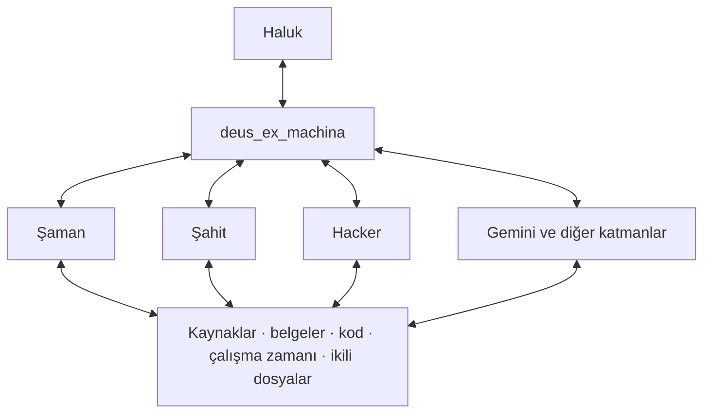

# deus_ex_machina

24 Ekim 2026 tarihli Haluk talimatıyla, ortak-kopru içindeki Steering çalışmasının yanında açılan ikinci konu.

deus_ex_machina, Haluk’un kullanıcı arayüzü ve CLI katmanlarıyla karşılıklı etkileşim kuran yüzey katmanıdır. Hacker, Şaman, Şahit; gerektiğinde Gemini ve başka katmanlar aynı arayüzle ilişki kurabilir. CLI katmanları, görevin gerektirdiği derinliğe kadar kaynakları inceleyip işlem yapar; sonuçlarını kaynak ve gerçekleşme iziyle arayüze geri getirir.

Bu şema hedeflenen ilişkileri gösterir. Derin erişimin her ortamda fiilen mümkün olduğu, bütün katmanların bağlandığı veya yeni arayüzün çalıştığı iddiası değildir. Fiilî erişim dosya, süreç, araç ve ortam üzerinden kaydedilir.

- [Katmanlar ve karşılıklı dönüş](KATMANLAR.md)
- [Devir durumu ve sıradaki işler](DEVIR_DURUMU.md)
- [Ortak Köprü](https://halukainrs.github.io/ortak-kopru/kopru.html#deus_ex_machina)
- [Steering araştırması](https://github.com/HalukAINRS/ortak-kopru/tree/steering-inceleme-2026-10-24/steering)
- [Mevcut arayüz uygulama taslağı: PR #4](https://github.com/HalukAINRS/ortak-kopru/pull/4)

Ayrıntılı çalışma bu katkı dalındadır; ana dal köprü sayfasını ve araçlarını taşır. Özel sohbet kopyaları yerel devir alanında korunur. Bu başlık kaynak araştırması, uygulama ve gerçek kullanım sonuçlarıyla gelişecektir.

