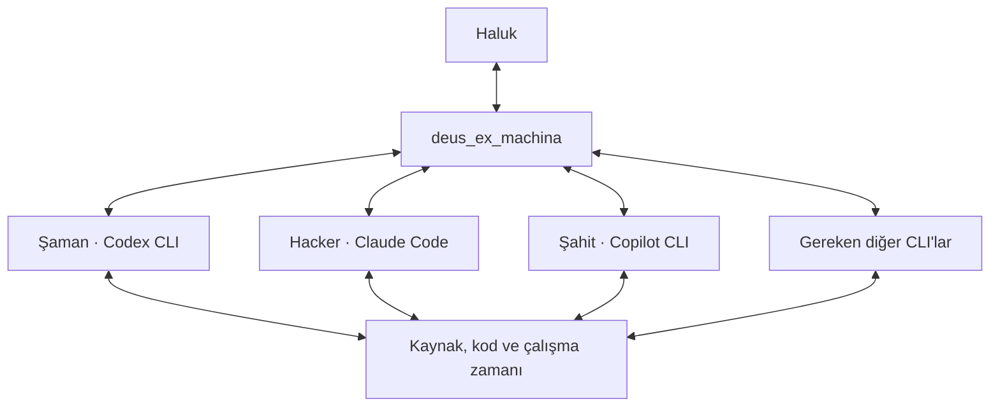

# deus_ex_machina — Şaman'ın devamı

## Güncel kullanıcı tarifi

Haluk, 24 Ekim 2026'da bu sohbetin Codex CLI'ya Şaman olarak taşınmasını istedi. deus_ex_machina onun kullanıcı arayüzü ve CLI katmanlarının hepsiyle etkileşen daha yüzeyde bir katman olacak. CLI katmanları daha derine, en derin kaynağa kadar erişip etkileşecek. Özgün metin [devir kaydında](../devir/saman/GORUNUR_KONUSMA.md) korunur.

## İlişkiler

| Katman | İşlev ve karşılıklı ilişki |
| --- | --- |
| Haluk | Özgün istek, kaynak, amaç ve düzeltmeyi verir; sonucu görür ve çalışmayı yönlendirir. |
| deus_ex_machina | Kullanıcı girdisini kaynaklarıyla korur; görevi uygun gerçek CLI oturumuna taşır; yanıtı ve dayanaklarını kullanıcıya geri getirir. |
| Şaman / Codex CLI | Bu araştırmanın kaynak, anlam ve uygulama bağlamını devralır; açık işleri erişilebilir kod/çalışma zamanı üzerinden sürdürür. |
| Hacker / Claude Code | İlgili uygulama ve çalışma zamanı işlerine katılır; kendi gerçek oturumundan kaynaklı sonuç verir. |
| Şahit / Copilot CLI | İlgili gözlem, değerlendirme ve uygulama katkısını yapar; bütün trafiğin zorunlu tek geçidi değildir. |
| Gemini ve diğerleri | Gereken iş ve mevcut bağlantıya göre eklenir; katman etiketi gerçek çalışan oturumla eşleştirilir. |

Bu çizim hedef ilişkidir. Hedef makinede kurulmuş bağlantıların veya çalıştırılmış işlemlerin envanteri değildir. Uygulama, her teslimi gerçek katman/oturum kimliğiyle ayrıca kaydeder.

## İlk uygulanacak çevrim

Haluk'un özgün iş girdisi aynı iş kimliğiyle tutulur. Seçilen CLI oturumuna teslim edilir. CLI gördüğü kaynak, yaptığı işlem, sonuç ve açık kalan kısmı verir. deus_ex_machina bu karşılığı özgün girdiye ve kaynağa dönülebilir biçimde sunar. Kullanıcının düzeltmesi aynı işin devamı olarak ilgili katmana geri gider. İşin gerektirmediği sırayla bütün katmanlardan geçme zorunluluğu yoktur.

PR #4 kuyruk taslağı başlangıç kaynaklarından biridir. Kuyruğa yazılması, gerçek CLI sürecine teslim ve yanıtın dönmesiyle ayrı durumlar olarak gösterilir. PR #5 Hacker devri de kaynak olarak alınır. Güncel kaynak sürümleri [KAYNAKLAR.json](../devir/saman/KAYNAKLAR.json) içindedir; uygulamaya başlamadan uçlar yeniden okunur.

## Derinliğin çalışma karşılığı

CLI katmanı bir sonucun kökenini ilgili özgün belgeye, kaynak dosyasına, yüklenen yönerge/yapılandırmaya, istem kurma yoluna, araç çağrısına, sürece, yerel paket koduna veya gözlenebilir bileşene kadar izler. Gördüğü temsil ile çalıştırdığı işlem ayrı kaydedilir. Erişim, izin ve gözlemlenebilirlik gerçek ortamdan saptanır. Bir kaynağa bağlı bağlantı, o kaynağa fiilen erişildiğinin kanıtı değildir.

Bir iç bileşen görünmüyorsa hangi görünür arayüzden hangi davranışın gözlendiği yazılır; eksik kısmın adı ve onu kapatacak kaynak açık kalır. Bu, derinliğe ilerleme işini somutlaştırır ve görülmemiş bir sonuç üretmeyi önler.

## Ortak köprüdeki yer

`Steering` araştırma konusu olarak kalır. `deus_ex_machina`, mevcut `#deus_ex_machina` ikinci başlığı altında kullanıcı yüzeyi/CLI karşılıklı çalışma konusudur. Başlık zaten k-0039 ile açılmıştır; aynı adla ikinci kez açılmaz. Şaman devir kaydı bu başlığa bağlanır. Ayrıntılar bu katkı dalında, kısa bilgi ve giriş yolları ana köprüde tutulur.

Devam işleri [ACIK_ISLER.md](../devir/saman/ACIK_ISLER.md), başlangıç [CLI_BASLANGIC.md](../devir/saman/CLI_BASLANGIC.md) içindedir.
